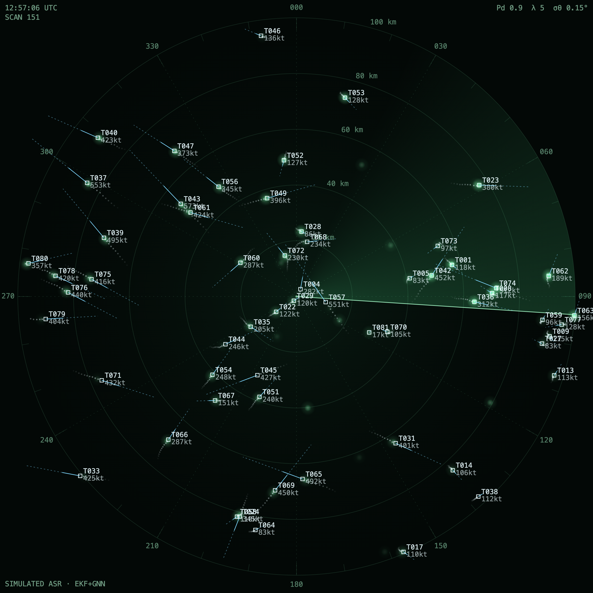
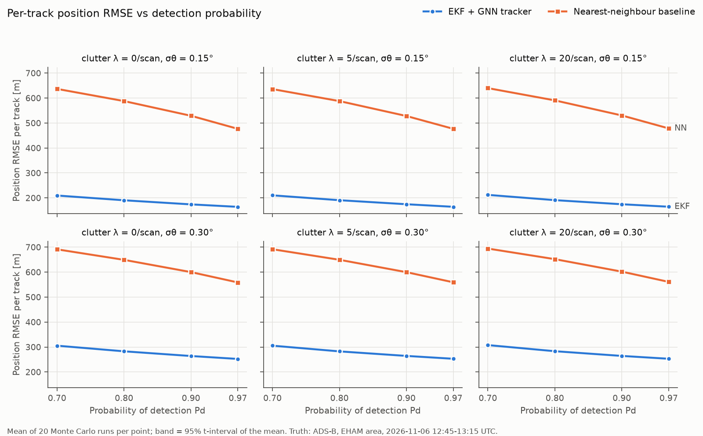
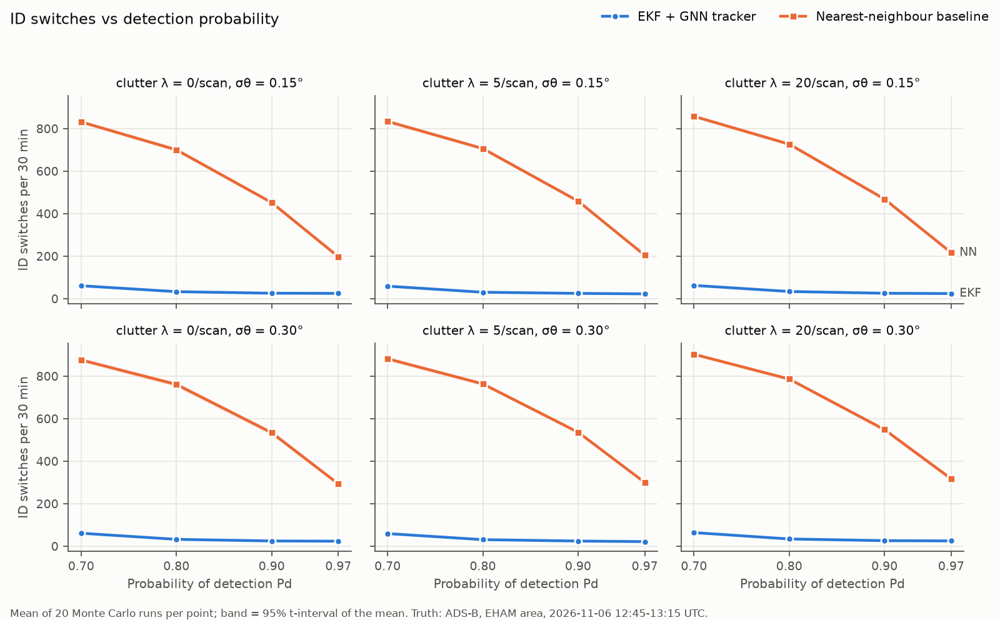
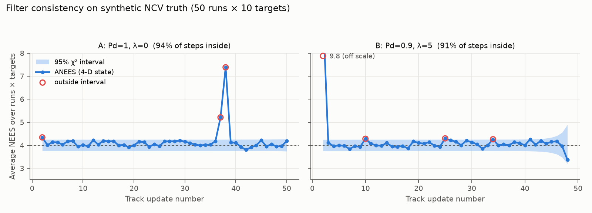

# Radar Track Lab

A multi-target radar tracker evaluated against real aircraft trajectories: recorded ADS-B positions around Amsterdam Schiphol serve as ground truth, a simulated airport surveillance radar produces noisy detections from them, and an EKF tracker with global nearest-neighbour association is compared with a filter-free nearest-neighbour baseline.

Built with AI coding agents (Claude, Codex); tests and verification by me.

> **Main finding.** Under the default condition (detection probability 0.9, 5 clutter detections per scan, 0.15° azimuth noise; mean of 20 Monte Carlo runs), the EKF tracker's position error per track is 175 m against 528 m for the baseline, and it changes track ID 24.9 times in 30 minutes against 459.2. Right after a detection update the gap is much smaller (126 m against 173 m, 27% lower): most of the difference comes from predicting between scans and keeping track identity through missed detections.



Default condition, one seed. Simulated detections on real aircraft trajectories within 100 km of Schiphol, 2026-11-06. An 8-second loop of the same view is in `results/thumbnails/scope_loop_8s.mp4`.

**Demo:** https://radar-track-lab.vercel.app (static page replaying pre-computed scenarios; interface text in Korean).

**Scope.** Civil airport surveillance radar (ASR) only. There is no threat evaluation, weapon assignment or intercept function. Aircraft flagged military, LADD or PIA in the readsb database are dropped at the first processing step; no registration, callsign or ICAO address is stored, and the demo shows anonymous track numbers only.

## Results

### Tracker against baseline

Default condition: Pd 0.9, clutter λ 5 per scan, σ_θ 0.15°. 30-minute evaluation window with 50.4 aircraft per scan on average. Mean of 20 Monte Carlo runs ± 95% t-interval of the mean.

| Lead measure | EKF + GNN | Baseline (NN) |
|---|---:|---:|
| Position RMSE per track [m] | 174.7 ± 1.2 | 528.1 ± 1.4 |
| ID switches (30 min) | 24.9 ± 2.1 | 459.2 ± 7.8 |

- Position RMSE is the error of tracks paired with a true aircraft, measured at the end of each scan. An ID switch is a change of the track number attached to one aircraft.
- Comparing positions right after a detection update gives 125.8 m against 172.8 m (27% lower). That is the filter's smoothing gain; the larger gap above comes from prediction between scans and from keeping track numbers.
  - Prediction: a baseline track stays at its last detection until the next one, so at the end of a scan it lags by however far the aircraft has moved since (up to 4.8 s of flight). The EKF track is extrapolated to that time.
  - Track identity: the baseline's ID switches depend strongly on Pd (832 at Pd 0.7 and 197 at Pd 0.97, with λ 0 and σ_θ 0.15°). After one missed detection an aircraft moves about 2.4 km over two scans (at 250 m/s), beyond the baseline's 2 km linking radius, and without prediction the baseline cannot reconnect it. The EKF gates on the predicted position and covariance and bridges one or two misses.

All measures:

| Measure | EKF + GNN | Baseline (NN) |
|---|---:|---:|
| Position RMSE, end of scan [m] | 174.7 ± 1.2 | 528.1 ± 1.4 |
| Position RMSE, right after update [m] | 125.8 ± 0.5 | 172.8 ± 0.6 |
| ID switches (30 min) | 24.9 ± 2.1 | 459.2 ± 7.8 |
| Track breaks (30 min) | 3.6 ± 0.7 | 414.2 ± 7.9 |
| Missed targets per scan | 0.82 ± 0.02 | 4.02 ± 0.07 |
| False tracks per scan | 1.08 ± 0.01 | 4.91 ± 0.07 |
| Track initiation delay, mean [s] | 13.8 ± 0.2 | 14.1 ± 0.3 |
| GOSPA [m] | 2,236 ± 10 | 5,508 ± 24 |
| ├ localisation part [m] | 1,229 ± 9 | 3,592 ± 8 |
| ├ missed-target part [m] | 1,282 ± 12 | 2,833 ± 23 |
| └ false-track part [m] | 1,468 ± 7 | 3,134 ± 21 |

GOSPA sums localisation error, missed targets and false tracks over all targets present at that time (α = 2, p = 2, cut-off c = 2 km). Its value depends on the number of targets and on c, so it does not read as the accuracy of one track; it appears in tables only.

Remaining EKF errors (`scripts/diagnose_errors.py`, mean of 20 runs):

- Of 1.08 false tracks per scan, 1.00 are tracks coasting for 5 scans after their aircraft left the truth (landing, leaving coverage, ADS-B gap). No track confirmed from clutter appeared under this condition.
- Of 0.82 missed targets per scan, 0.75 are new aircraft not yet confirmed by the 3-of-4 rule. The same rule explains the initiation delay of about 3 scans (14 s) for both methods.
- Of 24.9 ID switches, 7.0 follow an ADS-B gap longer than 20 s, 4.6 happen with another aircraft within 3 km (crossing traffic at different altitudes, which the 2-D model cannot separate), and 13.3 are tracks lost while the aircraft was continuously present.

### Noise sweep

Pd {0.7, 0.8, 0.9, 0.97} × clutter λ {0, 5, 20} × σ_θ {0.15°, 0.30°}, 20 runs per condition. The full table is section 3 of `results/RESULTS.md`; per-run values are in `results/data/sweep_runs.csv`.





- Position RMSE per track: EKF 164 → 210 m from Pd 0.97 to 0.7 at σ_θ 0.15°, and 252 → 305 m at 0.30°. Baseline 477 → 637 m and 559 → 691 m.
- RMSE right after update: EKF 124–132 m (σ_θ 0.15°) and 211–229 m (0.30°); baseline 172–173 m and 326–329 m. For the baseline this is the raw measurement error, so it does not depend on Pd.
- ID switches (30 min): EKF 22–26 at Pd ≥ 0.9, 30–34 at 0.8 and 59–64 at 0.7. Baseline 197–903.
- Raising clutter λ from 0 to 20 changed EKF RMSE by at most 2.6 m and ID switches by at most 3.0. This holds only up to a mean clutter density of 6.4×10⁻⁴ per km² per scan (λ 20; 3.2×10⁻³ at 10 km from the radar).

### Dense clutter (extra run)

Pd 0.9, σ_θ 0.15°, λ raised to 200 and 1000, 20 runs each (mean density 6.4×10⁻³ and 3.2×10⁻² per km² per scan).

| λ [per scan] | Method | Position RMSE [m] | ID switches (30 min) | False tracks / scan | Missed targets / scan |
|---:|---|---:|---:|---:|---:|
| 20 | EKF + GNN | 174.6 ± 1.1 | 25.5 ± 2.4 | 1.16 ± 0.02 | 0.85 ± 0.01 |
| 20 | Baseline | 530.3 ± 1.4 | 468.6 ± 8.2 | 5.56 ± 0.07 | 4.07 ± 0.06 |
| 200 | EKF + GNN | 184.6 ± 1.8 | 43.2 ± 3.0 | 12.23 ± 0.20 | 0.93 ± 0.02 |
| 200 | Baseline | 545.2 ± 1.3 | 692.8 ± 10.3 | 62.36 ± 0.52 | 4.35 ± 0.07 |
| 1000 | EKF + GNN | 230.1 ± 2.9 | 344.6 ± 17.0 | 555.22 ± 2.31 | 0.91 ± 0.03 |
| 1000 | Baseline | 576.5 ± 1.6 | 2,156.4 ± 15.1 | 1,016.35 ± 2.11 | 3.43 ± 0.04 |

- At λ 200 the EKF produces 12 false tracks per scan (against about 50 real aircraft) and 1.7 times as many ID switches; position RMSE rises by 10 m.
- At λ 1000 there are 555 false tracks per scan, about 11 times the number of real aircraft. A tentative track has no velocity after its first detection, so its gate is wide (radius about 2.7 km on the second scan), and at this density clutter alone easily meets the 3-of-4 confirmation rule. Stricter confirmation, a clutter map or probabilistic association (JPDA, MHT) would be the next things to try; none were tried here.

### Filter consistency (NEES)

Checked on synthetic truth that follows the filter's own model (nearly constant velocity, q = 25, initial velocity drawn from the tracker's prior): 50 runs × 10 targets, 50 scans.

| Case | Samples | Mean NEES (4-D) | 95% interval for that many samples | Steps inside per-step 95% interval |
|---|---:|---:|---|---:|
| A: Pd = 1, λ = 0 | 24,269 | 4.16 | [3.96, 4.04] | 93.9% (46/49) |
| B: Pd = 0.9, λ = 5 | 21,722 | 4.19 | [3.96, 4.04] | 91.5% |



- In case A, the mean NEES of 46 of 49 update steps lies inside its 95% interval, close to the nominal 95%.
- The overall mean of 4.16 is slightly above the interval for 24,000 samples. The spikes at updates 37–38 come from two samples 1.0 km and 1.4 km from the radar (NEES 1,707 and 528), where the EKF linearisation of polar measurements breaks down. Beyond 5 km the mean is 4.07, about 1% above the interval's upper bound (4.04). The largest deviation is at the first update (4.34), where velocity uncertainty is largest.
- Case B's 9.85 at the second update is an association error: tentative tracks started from clutter took over real detections (that step has 15 more samples than in case A).
- On the real ADS-B truth (default condition, 329,436 confirmed-track samples) the mean NEES is 2.85 and the median 2.00: q was set to follow turns, so the covariance is larger than the actual error on straight segments. Real trajectories do not follow the constant-velocity model, so this value was not used as a consistency test.

### What the numbers say

1. **The filter itself improves position by about a quarter; prediction and identity keeping do the rest.** Right after an update the EKF is 27% better than the raw detections. At the end of each scan its RMSE is 3.0 times lower than the baseline's, and it has 18 times fewer ID switches.
2. **In the tested range, detection probability and azimuth noise matter far more than clutter.** EKF ID switches rise from 22–26 at Pd ≥ 0.9 to 59–64 at Pd 0.7, and doubling σ_θ adds 88–96 m of RMSE, while clutter up to λ 20 changes RMSE by at most 2.6 m and ID switches by at most 3.0.
3. **Clutter matters once it is dense.** At λ 200 false tracks rise to 12 per scan, and at λ 1000 clutter alone passes the 3-of-4 confirmation rule (555 false tracks per scan). As configured, this tracker does not handle that density.

## Setup

### Data

- Source: [adsb.lol globe_history_2026](https://github.com/adsblol/globe_history_2026), release `v2026.11.06-planes-readsb-prod-0` (Friday 2026-11-06, one day), two split tar files of 1,907.3 MiB and 1,740.3 MiB.
- Area: within 100 km of Schiphol (EHAM). It is one of Europe's busiest airports, with 90–110 aircraft inside 100 km per 5 minutes in daytime (`results/data/traffic_profile.json`); receiver coverage in the Netherlands is dense down to low approach altitudes; and the flat terrain suits the 2-D model.
- `scripts/extract_region.py` streams the tar files without unpacking them and keeps aircraft with a point inside a 125 km box (about 200 s, about 470 MB peak memory).

| Step | Count |
|---|---:|
| Trace files | 75,277 |
| Non-ICAO addresses (`~` prefix, TIS-B etc.) skipped | 8,853 |
| Aircraft with a point in the box | 2,394 |
| of which dbFlags military (1), dropped | 40 |
| of which dbFlags LADD (8), dropped | 48 |
| of which dbFlags PIA (4), dropped | 0 |
| Remaining aircraft / points | 2,306 / 1,115,379 |

Remaining aircraft get integer numbers in file order only; not even a hash of the address is kept.

**Ground truth.** The evaluation window is 2026-11-06 12:45–13:15 UTC (30 min, 375 scans) and includes the busiest 5 minutes of the day (12:55). The process noise q was chosen only on a separate window, 10:00–10:15 UTC.

| Step (evaluation window ± 120 s) | Points |
|---|---:|
| ADS-B/MLAT points in the box | 52,695 |
| Source not `adsb_icao` (MLAT etc.) | −12,861 |
| Stale position flag | −229 |
| On the ground | −7,665 |
| NACp unknown | −2 |
| NACp < 8 | −1,118 |
| Kept (246 segments, 229 aircraft) | 30,810 |

- NACp ≥ 8 means a 95% horizontal position bound under 92.6 m. Most kept points are NACp 9–11 (under 30 m, 10 m and 3 m).
- A trajectory is cut where points are more than 20 s apart or readsb marks a new leg. During a cut the aircraft is absent from both the simulation and the truth.
- ADS-B velocity (ground speed and track) refers to true north at the aircraft and is rotated into the radar's local frame (meridian convergence about 1.3° at 100 km east).
- Positions at each radar illumination time come from cubic Hermite interpolation with the ADS-B velocity vectors as end-point slopes.
- Result: 50.4 aircraft per scan on average (maximum 58), 149 aircraft over the 30 minutes.

**Interpolation error** (leave-one-out: each inner point removed and interpolated from its neighbours; 25,756 points):

| Gap between neighbours [s] | n | Hermite RMS [m] | Hermite p95 [m] | Linear RMS [m] |
|---|---:|---:|---:|---:|
| 0–2 | 5,607 | 5.8 | 10.8 | 5.8 |
| 4–6 | 4,113 | 5.7 | 10.7 | 8.9 |
| 8–10 | 2,251 | 6.4 | 11.1 | 10.2 |
| 15–20 | 1,758 | 7.1 | 14.3 | 14.0 |

- Overall: Hermite median 3.7 m, RMS 6.3 m, p95 11.8 m. The gaps that actually bracket radar illumination times have a median of 9.9 s and p95 of 19.9 s; the estimated RMS interpolation error at those gaps is about 6.7 m.
- About 6 m remains even at 0–2 s gaps, which points to quantisation and timing jitter in the ADS-B positions rather than interpolation.
- This is an order of magnitude below the radar noise (50 m in range; 0.15° is about 131 m at 50 km), so its effect on the evaluation is small, but not zero.

### Virtual radar

A 2-D rotating radar at the Schiphol reference point. Each scan the antenna starts at north (azimuth 0°) and turns clockwise; a detection is made when the beam passes the target's azimuth, so every detection has its own time (`t_k + azimuth/ω`). Measurements are polar (range, azimuth) with a fixed seed.

| Parameter | Default | Sweep | Basis |
|---|---|---|---|
| Rotation period | 4.8 s (12.5 rpm) | – | ASR-11 antenna 12.5 rpm, primary range 60 NM [1] |
| Maximum range | 100 km | – | Inside 60 NM (111 km) |
| Minimum range | 1 km | – | Chosen |
| Range noise σ_r | 50 m | – | Chosen (see below) |
| Azimuth noise σ_θ | 0.15° | 0.15°, 0.30° | Manufacturer PSR azimuth accuracy example of 0.15° RMS [2]; 0.30° is a poor condition at twice that |
| Detection probability Pd | 0.9 | 0.7, 0.8, 0.9, 0.97 | EUROCONTROL standard: PSR position detection > 90% [2][3] |
| Clutter | Poisson, λ = 5 per scan | 0, 5, 20 (extra: 200, 1000) | Same standard: PSR false targets < 20 per scan [2][3] |

- σ_r = 50 m is my choice, not a sourced value; it is better in range than the example specification in [2] (100 m, 0.1°).
- [2] notes that real azimuth errors can exceed manufacturer figures (up to about 0.6° at 50 NM), which is why the 0.30° condition is included.
- Clutter is uniform in range (1–100 km) and in azimuth, i.e. the same false-alarm probability per resolution cell, so its density per area falls as 1/range. Coverage is 31,413 km².

  | λ [per scan] | Mean density [/km²/scan] | at 10 km | at 50 km | at 90 km |
  |---:|---:|---:|---:|---:|
  | 5 | 1.6×10⁻⁴ | 8.0×10⁻⁴ | 1.6×10⁻⁴ | 8.9×10⁻⁵ |
  | 20 | 6.4×10⁻⁴ | 3.2×10⁻³ | 6.4×10⁻⁴ | 3.6×10⁻⁴ |
  | 200 (extra) | 6.4×10⁻³ | 3.2×10⁻² | 6.4×10⁻³ | 3.6×10⁻³ |
  | 1000 (extra) | 3.2×10⁻² | 1.6×10⁻¹ | 3.2×10⁻² | 1.8×10⁻² |
- Pd is a constant, independent of range, altitude and target size.

All settings are in `configs/default.yaml`.

### Tracker

`src/radar_track_lab/tracker.py`

- State `[x, y, vx, vy]`, nearly-constant-velocity (white-noise acceleration) model, process noise PSD q = 25 m²/s³.
- Measurement model `h(x) = [√(x²+y²), atan2(x, y)]`, azimuth innovation wrapped to [−π, π), Joseph-form covariance update.
- Detections have different times, so each track–detection pair is predicted to that detection's time before gating.
- Gating: squared Mahalanobis distance of the 2-D innovation ≤ χ²₂(0.999) = 13.8.
- Association: cost `d² + ln|S|` solved with `scipy.optimize.linear_sum_assignment`, separately for each connected group of gated pairs. Confirmed tracks are associated first, then tentative tracks; leftover detections start new tentative tracks.
- Initiation: first detection position (polar covariance converted to Cartesian), zero velocity with σ 150 m/s.
- M-of-N: confirmed after 3 detections in the first 4 scans, deleted as soon as that becomes impossible. Confirmed tracks are deleted after 5 consecutive misses. Track numbers are never reused.
- q was chosen on the tuning window from {1, 4, 9, 16, 25, 36, 49, 64, 100, 200} as the value with the lowest mean GOSPA over 5 seeds. q = 25 and 36 differed by 1 m, and 25 was kept by the rule fixed beforehand (`results/data/tune_q.json`).

The baseline (`NearestNeighborBaseline`) uses the last detection as the track position and greedily links the nearest detection within 2 km. Its track management (3-of-4 confirmation, deletion after 5 misses) is the same, so differences come only from filtering, prediction and gating.

The optional CV + coordinated-turn IMM was not implemented.

### Evaluation

- Evaluation time: the end of each scan. Confirmed tracks are predicted to that time (the baseline keeps its last detection) and compared with the ADS-B truth at the same time. The first 60 s are excluded.
- GOSPA: α = 2, p = 2, c = 2 km. The parts are root-mean values of the additive terms, so `mean(GOSPA²) = localisation² + missed² + false²`.
- Position RMSE: RMS over GOSPA-paired (distance < c) track–truth pairs. "RMSE right after update" uses confirmed-track positions just after a detection update against the truth at that time, which excludes prediction error.
- ID switch: a change of the track number paired with one true aircraft.
- Track break: a paired aircraft still in the truth on the next scan but without a pair.
- Initiation delay: for aircraft that appear during the window, the time from their first scan in the truth to their first pairing with a confirmed track.
- Monte Carlo: 20 seeds per condition (20261106–20261125). The truth is the same; only noise, detections and clutter change. Tracker and baseline receive identical detections for the same seed. ± is the 95% t-interval of the mean.

## How it was verified

- **Unit tests (20, `tests/`)**: azimuth convention, polar–Cartesian and geodetic–ENU round trips, polar covariance, velocity rotation for meridian convergence; EKF convergence on a straight line and error below raw measurements; the χ² gate value and rejection of a far detection; a globally optimal assignment where greedy fails; M-of-N confirmation and deletion; track numbers persisting and never reused; assignment by connected groups matching one dense solve in number of pairs and total cost (200 random sparse cost matrices); GOSPA on hand-computed cases; identical results for the same seed and different ones for another seed; clutter count matching λ; Hermite interpolation exact for constant acceleration; NEES interval containing the degrees of freedom; dbFlags exclusion of military, PIA and LADD aircraft.
- **Separate tuning window.** q was chosen on 10:00–10:15 UTC with a rule fixed in advance and never adjusted on the evaluation window.
- **Same detections for both methods.** For each seed the tracker and the baseline see the same detections, and both use the same track management.
- **Filter consistency** on synthetic truth that follows the model (NEES section above), so a mismatch shows up as a statistical failure rather than being hidden by model error.
- **Truth error measured** by leave-one-out interpolation rather than assumed.
- **Association change checked for equality.** Splitting the assignment into connected groups (needed for λ 1000) gave identical summaries at λ 5 and 20 to the dense solve before the change, and a unit test compares the two on 200 random sparse cost matrices (same number of pairs, same total cost).
- **Generated tables.** `results/RESULTS.md` is written by `scripts/write_results_md.py` from the JSON in `results/data/`; no number in it is typed by hand.
- **Provenance.** Seeds are fixed. This public repository starts from a fresh history; development happened in a private repository.

## Limits

- **2-D plane.** Altitude and slant range are ignored. Aircraft at different altitudes that cross in the plane cannot be told apart, as with a real primary radar. There is no overhead cone of silence, vertical coverage or low-altitude shadowing from Earth curvature.
- **No IMM.** With a single constant-velocity model the prediction lags in turns, and a track that leaves its gate becomes an ID switch. Of the 24.9 ID switches under the default condition, 13.3 are tracks lost while the aircraft was present; turns are the likely main cause, but they were not checked one by one.
- **EKF linearisation near the radar.** Within 5 km the linearisation error of polar measurements is large: synthetic-truth NEES is 14.8 there (211 samples) against 4.07 beyond 5 km.
- **Truth error.** NACp 8 points have a 95% horizontal bound under 92.6 m, so truth positions can be off by up to tens of metres (9.5% of points in the evaluation window), plus about 6–7 m RMS interpolation error. Aircraft disappear and reappear around ADS-B gaps longer than 20 s, which causes some ID switches and false tracks.
- **Textbook radar parameters.** The values are generic figures from standards and public documents and do not model a specific system. Pd is constant, clutter is uniform, noise is Gaussian and unbiased, and there is no resolution limit (no merging of close targets) and no multipath. The finding that clutter has little effect holds only for λ ≤ 20 (mean 6.4×10⁻⁴ per km² per scan).
- **Not tested on a real phone.** The demo was checked only with headless Chrome, including mobile emulation.
- Only ADS-B-equipped aircraft are in the truth. The 54 aircraft seen only by MLAT in the evaluation window (probably mostly light aircraft) and aircraft moving on the ground are left out of the simulation as well.
- One 30-minute window at one airport on one day. q was chosen on another 15-minute window of the same day.
- The demo shows one seed and 10 minutes per condition, so its live values can differ from the 20-run means in the tables.

## Demo

`web/index.html` plus `web/data/*.json`; no server code. Live copy: https://radar-track-lab.vercel.app (the `web/` folder deployed as static files).

```sh
python3 -m http.server 8765 --directory web   # then open http://127.0.0.1:8765/
```

A static server is needed because browsers block JSON reads from `file://`.

- PPI scope (canvas 2D): rotating sweep, detections fading over about 2.5 turns, clutter, confirmed-track symbols with anonymous numbers (T001…), 30 s velocity vectors, 90 s predicted paths (dashed) and 10-scan trails.
- Track symbols update when the sweep passes their azimuth and are extrapolated with constant velocity between scans.
- Truth overlay toggle: true positions (diamonds) and trails, with clutter detections and false tracks (not paired with any aircraft) in different colours. This distinction exists only because it is a simulation; a real radar cannot know it.
- Play/pause (space bar), speed 1/2/4/8×, position slider; clicking a track shows its range, speed and heading.
- Six conditions: default (Pd 0.9, λ 5, σ_θ 0.15°), low Pd (0.7), more clutter (λ 20), larger azimuth noise (0.30°), all poor (0.7, 20, 0.30°), good (0.97, 0, 0.15°).
- Side panel: GOSPA of the current scan (with the baseline's value on the same detections), the last 5 minutes of GOSPA, and counts of confirmed tracks, true aircraft, false tracks and missed aircraft.
- Data: `scripts/export_demo.py` re-runs the 30-minute window with seed 20261106 and stores 10 minutes (125 scans) from minute 6 as integer arrays, 360–480 KiB per condition.
- On screens up to 860 px wide or touch devices a lighter drawing mode is on by default (pixel ratio capped at 1.5, simpler afterglow, 6-scan trails, 30 fps cap).

Thumbnails (`results/thumbnails/`) were rendered from the demo page with `?thumb=1` in headless Chrome by `scripts/render_thumbnails.mjs`, frame by frame at fixed simulation times. The 8-second loop covers exactly 4 turns (19.2 s of simulation) with a 0.8 s crossfade at the end; MP4 encoding uses a small AVFoundation tool, `scripts/tools/png2mp4.swift`.

## Run it

Python 3.12. The unit tests use no data:

```sh
git clone https://github.com/hyh4867/radar-track-lab.git
cd radar-track-lab
python3 -m venv .venv && . .venv/bin/activate
python -m pip install -r requirements.txt
python -m pytest -q
```

The full pipeline downloads about 3.6 GiB:

```sh
mkdir -p data/raw/adsblol_2026-11-06 && cd data/raw/adsblol_2026-11-06
gh release download -R adsblol/globe_history_2026 v2026.11.06-planes-readsb-prod-0 --pattern '*.tar.a?'
shasum -a 256 *.tar.a?   # compare with the values below
cd ../../..
cat data/raw/adsblol_2026-11-06/*.tar.a? | python -I scripts/extract_region.py

python scripts/traffic_profile.py
python scripts/build_truth.py
python scripts/tune_q.py            # chooses q on the tuning window only
python scripts/run_compare.py       # default condition, 20 runs
python scripts/run_nees.py
python scripts/run_sweep.py         # 24 conditions x 20 runs x 2 methods, about 4 min
python scripts/run_heavy_clutter.py # λ 200 and 1000, about 5 min
python scripts/diagnose_errors.py
python scripts/make_figures.py
python scripts/write_results_md.py
python scripts/export_demo.py       # demo data in web/data/
```

| File | SHA-256 |
|---|---|
| `v2026.11.06-planes-readsb-prod-0.tar.aa` | `b2881ccedefd1d5e18f5e295def377ce12c6be976d3973907d48620d106987ab` |
| `v2026.11.06-planes-readsb-prod-0.tar.ab` | `1010a1ddd625a983ee4441a564d62afac0923179f76a4bd82c7352e6ed1fffdc` |

Run times are from an 8 GiB Apple M2. Raw and processed data stay in `data/`, which Git ignores.

```text
configs/default.yaml        radar, tracker and evaluation settings
src/radar_track_lab/
  geo.py                    WGS84 to local ENU, polar conversion, velocity rotation
  truth.py                  ADS-B filters, segmenting, Hermite interpolation, leave-one-out error
  radar.py                  rotating-radar illumination times, polar detections and clutter
  ekf.py                    NCV prediction, polar EKF update, NEES
  tracker.py                EKF + GNN tracker, nearest-neighbour baseline, M-of-N
  metrics.py                GOSPA, ID switches, breaks, initiation delay, NEES intervals
  sim.py, synthetic.py      scenario set-up and single runs, synthetic NCV truth
scripts/                    extraction, experiments, figures and tables, demo export, thumbnails
results/RESULTS.md          all result tables (generated from results/data/)
results/data/, figures/     JSON/CSV results and figures
results/thumbnails/         still image and loop video
web/                        static demo and pre-computed scenarios
tests/                      pytest
```

## Data, references and licenses

The raw ADS-B archives are not redistributed here; download them as above.

- Position data: adsb.lol globe_history_2026, 2026-11-06. Contains information from adsb.lol, made available under the [Open Database License (ODbL) 1.0](https://opendatacommons.org/licenses/odbl/1-0/). The trajectory-derived data in `results/` and `web/data/` is likewise made available under the ODbL 1.0.
- Code: MIT License, see `LICENSE`.
- Dependencies: NumPy and SciPy (BSD-3-Clause), Matplotlib (PSF-based), PyYAML and pytest (MIT).

References:

1. Wikipedia, "ASR-11": antenna 12.5 rpm, primary range 60 NM, horizontal beamwidth 1.4°. https://en.wikipedia.org/wiki/ASR-11
2. ICAO APAC SURICG/6 IP/04 (2021), "Practical approach to assess the performance of the surveillance systems": table of EUROCONTROL PSR requirements (position detection > 90%, false targets < 20 per scan) and a PSR azimuth accuracy example of 0.15° RMS. https://www.icao.int/sites/default/files/APAC/Meetings/2021/2021%20SURICG%206/4-Information%20Papers/IP04_ROK-AI.7-Practical-approach-to-assess-the-performance-of-surveillance-systems-r1.pdf
3. EUROCONTROL, "Standard Document for Radar Surveillance in En-Route Airspace and Major Terminal Areas", SUR.ET1.ST01.1000-STD-01-01, Ed. 1.0, 1997 (checked through its citation in [2]).
4. Y. Bar-Shalom, X. R. Li, T. Kirubarajan, *Estimation with Applications to Tracking and Navigation*, Wiley, 2001: white-noise acceleration model, NEES test.
5. S. Blackman, R. Popoli, *Design and Analysis of Modern Tracking Systems*, Artech House, 1999: GNN association, M-of-N confirmation.
6. A. S. Rahmathullah, Á. F. García-Fernández, L. Svensson, "Generalized optimal sub-pattern assignment metric", FUSION 2017: GOSPA.
7. wiedehopf/readsb, `README-json.md`: trace format and dbFlags (military 1, PIA 4, LADD 8). https://github.com/wiedehopf/readsb/blob/dev/README-json.md
