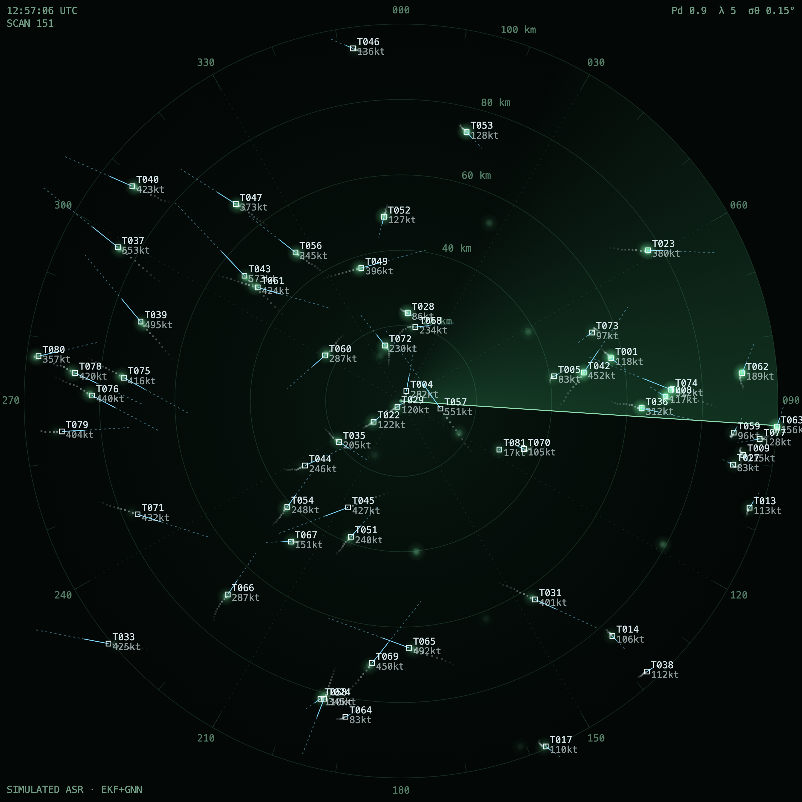
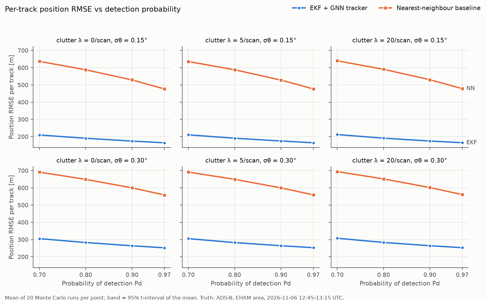
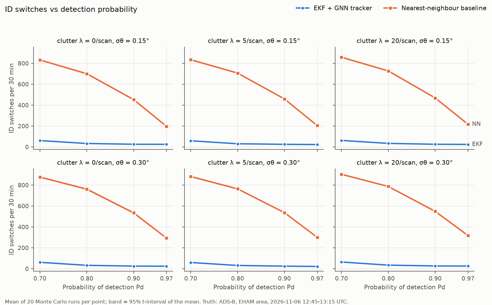
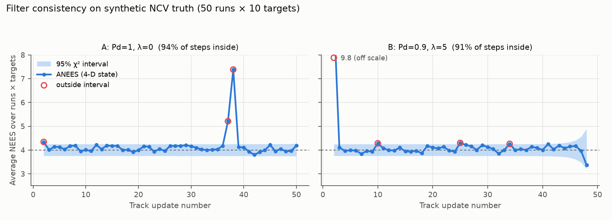
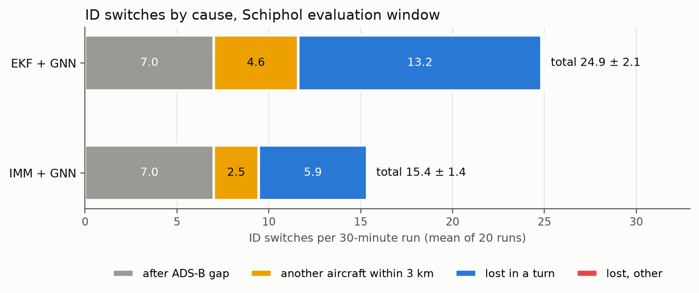
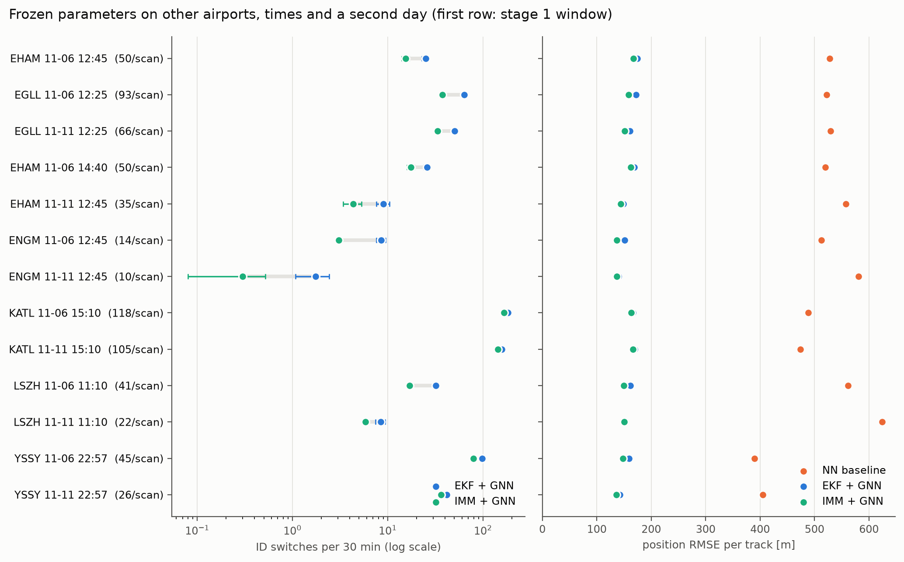
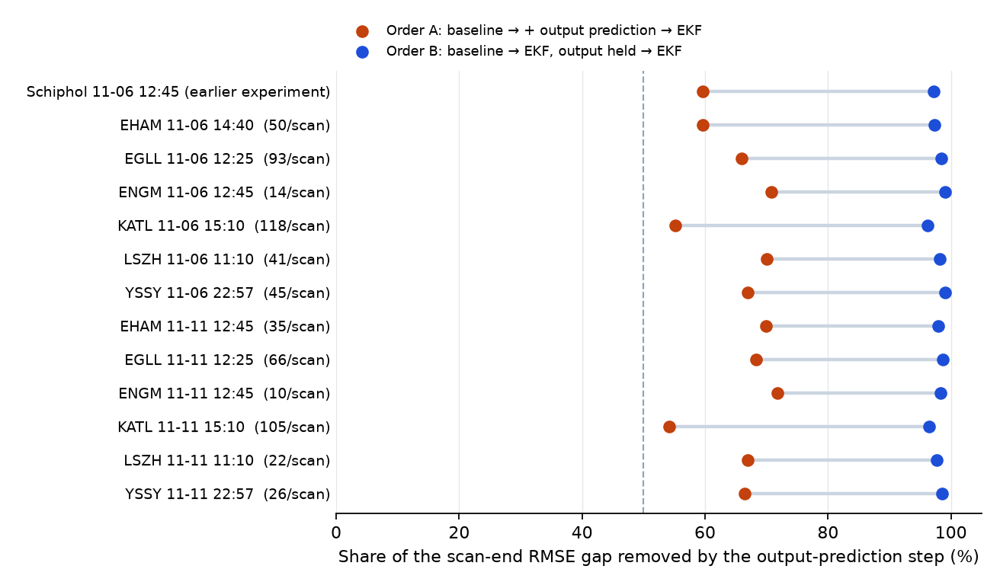

# Radar Track Lab

A multi-target radar tracker evaluated against real aircraft trajectories: recorded ADS-B positions around Amsterdam Schiphol serve as ground truth, a simulated airport surveillance radar produces noisy detections from them, and an EKF tracker with global nearest-neighbour association is compared with a filter-free nearest-neighbour baseline.

Built with AI coding agents (Claude, Codex); tests and verification by me.

The work ran in stages, each with its questions, predictions and verdict rules committed before the runs:

- **Stage 1** (sections up to "Results"): EKF + GNN against a nearest-neighbour baseline at Schiphol.
- **Stage 2** (`docs/PREREGISTRATION_2.md`): why tracks were lost, an IMM, a cross-check with Stone Soup, and frozen parameters on five more airports and a second day.
- **Evaluation audit**: which samples the RMSEs use and how much of the gap comes from prediction.
- **Stage 3** (`docs/PREREGISTRATION_3.md`): the stage 2 conclusions re-checked under a more realistic sensor model (E1–E4), the pre-gate fix, and JPDA/JIPDA in dense clutter.

Stage 1 text below is kept as first published. Lines marked "Update (stage 2)" or "Update (stage 3)" were added later.

> **Main finding.** Under the default condition (detection probability 0.9, 5 clutter detections per scan, 0.15° azimuth noise; mean of 20 Monte Carlo runs), the EKF tracker's position error per track is 175 m against 528 m for the baseline, and it changes track ID 24.9 times in 30 minutes against 459.2. Right after a detection update the gap is much smaller (126 m against 173 m, 27% lower): most of the difference comes from predicting between scans and keeping track identity through missed detections.



Default condition, one seed. Simulated detections on real aircraft trajectories within 100 km of Schiphol, 2026-11-06. An 8-second loop of the same view is in `results/thumbnails/scope_loop_8s.mp4`.

**Demo:** https://radar-track-lab.vercel.app (static page replaying pre-computed scenarios; interface text in Korean).

**Scope.** Civil airport surveillance radar (ASR) only. There is no threat evaluation, weapon assignment or intercept function. Aircraft flagged military, LADD or PIA in the readsb database are dropped at the first processing step; no registration, callsign or ICAO address is stored, and the demo shows anonymous track numbers only.

## Results (stage 1)

### Tracker against baseline

Default condition: Pd 0.9, clutter λ 5 per scan, σ_θ 0.15°. 30-minute evaluation window with 50.4 aircraft per scan on average. Mean of 20 Monte Carlo runs ± 95% t-interval of the mean.

| Lead measure | EKF + GNN | Baseline (NN) |
|---|---:|---:|
| Position RMSE per track [m] | 174.7 ± 1.2 | 528.1 ± 1.4 |
| ID switches (30 min) | 24.9 ± 2.1 | 459.2 ± 7.8 |

- Position RMSE is the error of tracks paired with a true aircraft, measured at the end of each scan. An ID switch is a change of the track number attached to one aircraft.
- Comparing positions right after a detection update gives 125.8 m against 172.8 m (27% lower). That is the filter's smoothing gain; the larger gap above comes from prediction between scans and from keeping track numbers.
  - Prediction: a baseline track stays at its last detection until the next one, so at the end of a scan it lags by however far the aircraft has moved since (up to 4.8 s of flight). The EKF track is extrapolated to that time.
  - Track identity: the baseline's ID switches depend strongly on Pd (832 at Pd 0.7 and 197 at Pd 0.97, with λ 0 and σ_θ 0.15°). After one missed detection an aircraft moves about 2.4 km over two scans (at 250 m/s), beyond the baseline's 2 km linking radius, and without prediction the baseline cannot reconnect it. The EKF gates on the predicted position and covariance and bridges one or two misses.

All measures:

| Measure | EKF + GNN | Baseline (NN) |
|---|---:|---:|
| Position RMSE, end of scan [m] | 174.7 ± 1.2 | 528.1 ± 1.4 |
| Position RMSE, right after update [m] | 125.8 ± 0.5 | 172.8 ± 0.6 |
| ID switches (30 min) | 24.9 ± 2.1 | 459.2 ± 7.8 |
| Track breaks (30 min) | 3.6 ± 0.7 | 414.2 ± 7.9 |
| Missed targets per scan | 0.82 ± 0.02 | 4.02 ± 0.07 |
| False tracks per scan | 1.08 ± 0.01 | 4.91 ± 0.07 |
| Track initiation delay, mean [s] | 13.8 ± 0.2 | 14.1 ± 0.3 |
| GOSPA [m] | 2,236 ± 10 | 5,508 ± 24 |
| ├ localisation part [m] | 1,229 ± 9 | 3,592 ± 8 |
| ├ missed-target part [m] | 1,282 ± 12 | 2,833 ± 23 |
| └ false-track part [m] | 1,468 ± 7 | 3,134 ± 21 |

GOSPA sums localisation error, missed targets and false tracks over all targets present at that time (α = 2, p = 2, cut-off c = 2 km). Its value depends on the number of targets and on c, so it does not read as the accuracy of one track; it appears in tables only.

Remaining EKF errors (`scripts/diagnose_errors.py`, mean of 20 runs):

- Of 1.08 false tracks per scan, 1.00 are tracks coasting for 5 scans after their aircraft left the truth (landing, leaving coverage, ADS-B gap). No track confirmed from clutter appeared under this condition.
- Of 0.82 missed targets per scan, 0.75 are new aircraft not yet confirmed by the 3-of-4 rule. The same rule explains the initiation delay of about 3 scans (14 s) for both methods.
- Of 24.9 ID switches, 7.0 follow an ADS-B gap longer than 20 s, 4.6 happen with another aircraft within 3 km (crossing traffic at different altitudes, which the 2-D model cannot separate), and 13.3 are tracks lost while the aircraft was continuously present.

### Noise sweep

Pd {0.7, 0.8, 0.9, 0.97} × clutter λ {0, 5, 20} × σ_θ {0.15°, 0.30°}, 20 runs per condition. The full table is section 3 of `results/RESULTS.md`; per-run values are in `results/data/sweep_runs.csv`.





- Position RMSE per track: EKF 164 → 210 m from Pd 0.97 to 0.7 at σ_θ 0.15°, and 252 → 305 m at 0.30°. Baseline 477 → 637 m and 559 → 691 m.
- RMSE right after update: EKF 124–132 m (σ_θ 0.15°) and 211–229 m (0.30°); baseline 172–173 m and 326–329 m. For the baseline this is the raw measurement error, so it does not depend on Pd.
- ID switches (30 min): EKF 22–26 at Pd ≥ 0.9, 30–34 at 0.8 and 59–64 at 0.7. Baseline 197–903.
- Raising clutter λ from 0 to 20 changed EKF RMSE by at most 2.6 m and ID switches by at most 3.0. This holds only up to a mean clutter density of 6.4×10⁻⁴ per km² per scan (λ 20; 3.2×10⁻³ at 10 km from the radar).

### Dense clutter (extra run)

Pd 0.9, σ_θ 0.15°, λ raised to 200 and 1000, 20 runs each (mean density 6.4×10⁻³ and 3.2×10⁻² per km² per scan).

| λ [per scan] | Method | Position RMSE [m] | ID switches (30 min) | False tracks / scan | Missed targets / scan |
|---:|---|---:|---:|---:|---:|
| 20 | EKF + GNN | 174.6 ± 1.1 | 25.5 ± 2.4 | 1.16 ± 0.02 | 0.85 ± 0.01 |
| 20 | Baseline | 530.3 ± 1.4 | 468.6 ± 8.2 | 5.56 ± 0.07 | 4.07 ± 0.06 |
| 200 | EKF + GNN | 184.6 ± 1.8 | 43.2 ± 3.0 | 12.23 ± 0.20 | 0.93 ± 0.02 |
| 200 | Baseline | 545.2 ± 1.3 | 692.8 ± 10.3 | 62.36 ± 0.52 | 4.35 ± 0.07 |
| 1000 | EKF + GNN | 230.1 ± 2.9 | 344.6 ± 17.0 | 555.22 ± 2.31 | 0.91 ± 0.03 |
| 1000 | Baseline | 576.5 ± 1.6 | 2,156.4 ± 15.1 | 1,016.35 ± 2.11 | 3.43 ± 0.04 |

- At λ 200 the EKF produces 12 false tracks per scan (against about 50 real aircraft) and 1.7 times as many ID switches; position RMSE rises by 10 m.
- At λ 1000 there are 555 false tracks per scan, about 11 times the number of real aircraft. A tentative track has no velocity after its first detection, so its gate is wide (radius about 2.7 km on the second scan), and at this density clutter alone easily meets the 3-of-4 confirmation rule. Stricter confirmation, a clutter map or probabilistic association (JPDA, MHT) would be the next things to try; none were tried here.
  - Update (stage 3): JIPDA, which manages tracks by existence probability, cut λ 1000 false tracks from 556.6 to 1.4 per scan, given the true clutter density. JPDA with the 3-of-4 rule unchanged was worse than GNN (1,186.7 per scan). Source: `results/stage3/b_summary.md`.

### Filter consistency (NEES)

Checked on synthetic truth that follows the filter's own model (nearly constant velocity, q = 25, initial velocity drawn from the tracker's prior): 50 runs × 10 targets, 50 scans.

| Case | Samples | Mean NEES (4-D) | 95% interval for that many samples | Steps inside per-step 95% interval |
|---|---:|---:|---|---:|
| A: Pd = 1, λ = 0 | 24,269 | 4.16 | [3.96, 4.04] | 93.9% (46/49) |
| B: Pd = 0.9, λ = 5 | 21,722 | 4.19 | [3.96, 4.04] | 91.5% |



- In case A, the mean NEES of 46 of 49 update steps lies inside its 95% interval, close to the nominal 95%.
- The overall mean of 4.16 is slightly above the interval for 24,000 samples. The spikes at updates 37–38 come from two samples 1.0 km and 1.4 km from the radar (NEES 1,707 and 528), where the EKF linearisation of polar measurements breaks down. Beyond 5 km the mean is 4.07, about 1% above the interval's upper bound (4.04). The largest deviation is at the first update (4.34), where velocity uncertainty is largest.
- Case B's 9.85 at the second update is an association error: tentative tracks started from clutter took over real detections (that step has 15 more samples than in case A).
- On the real ADS-B truth (default condition, 329,436 confirmed-track samples) the mean NEES is 2.85 and the median 2.00: q was set to follow turns, so the covariance is larger than the actual error on straight segments. Real trajectories do not follow the constant-velocity model, so this value was not used as a consistency test.

### What the numbers say

1. **The filter itself improves position by about a quarter; prediction and identity keeping do the rest.** Right after an update the EKF is 27% better than the raw detections. At the end of each scan its RMSE is 3.0 times lower than the baseline's, and it has 18 times fewer ID switches.
2. **In the tested range, detection probability and azimuth noise matter far more than clutter.** EKF ID switches rise from 22–26 at Pd ≥ 0.9 to 59–64 at Pd 0.7, and doubling σ_θ adds 88–96 m of RMSE, while clutter up to λ 20 changes RMSE by at most 2.6 m and ID switches by at most 3.0.
3. **Clutter matters once it is dense.** At λ 200 false tracks rise to 12 per scan, and at λ 1000 clutter alone passes the 3-of-4 confirmation rule (555 false tracks per scan). As configured, this tracker does not handle that density.

## Stage 2: causes of lost tracks, IMM, Stone Soup, other airports

Questions, predictions and verdict rules were committed in `docs/PREREGISTRATION_2.md` before any run. Default radar condition (Pd 0.9, λ 5 per scan, σ_θ 0.15°), 20 seeds, mean ± 95% t-interval; differences between methods are paired by seed and given as mean [95% interval]. Full tables: `results/RESULTS.md` (Stage 2 part, generated from `results/data/stage2/`); report: `docs/reports/2026-11-20-radar-track-lab-stage2.md` (Korean).

**Q1. Why did the stage 1 EKF lose tracks?** Each of the 267 "target present, track lost" ID switches (13.35 per run) was classified by the first cause that applies (`results/data/stage2/lost_tracks_ekf_eval.csv`).

| Cause (first that applies) | Events | Share |
|---|---:|---:|
| Turn: peak turn rate ≥ 1°/s in the window | 265 | 99.3% |
| ≥ 2 missed detections in the window | 1 | 0.4% |
| Within 5 km of the radar | 0 | 0.0% |
| Speed change ≥ 1 m/s² | 0 | 0.0% |
| None of these | 1 | 0.4% |

- Verdict by the preregistered rule: **turn is the main cause** (99.3% of lost tracks against a 19.3% base rate of turns in all assigned target-scans).
- The events are concentrated: 181 of 267 (68%) come from two slow aircraft circling tightly (median speed 62 and 74 m/s). The other 38 aircraft account for 86 events.
- Update (stage 3): under the most realistic stage 3 sensor model (M4: range-dependent Pd, altitude geometry, clutter map, merging) the turn share is 65% against a 15% base rate, so "turn is the main cause" still holds by the same rule. Without those two aircraft it is 38%, which the rule calls "partial" (`results/stage3/a_summary.json`).

**Q2. IMM (nearly constant velocity + coordinated turn).** `src/radar_track_lab/imm.py`, tested first on synthetic truth (`tests/test_imm.py`). Parameters were chosen on the tuning window only (64 combinations, 10 seeds, `results/data/stage2/tune_imm.json`): q_cv = 25, q_ct = 25, omega_noise_dps = 0.3, tau_cv_s = 300, tau_ct_s = 40. All but q_ct are the largest values of their grid; the grid was not extended.

| Measure (Schiphol evaluation window) | NN baseline | EKF + GNN | IMM + GNN | IMM − EKF, paired |
|---|---:|---:|---:|---:|
| Position RMSE, end of scan [m] | 528.1 ± 1.4 | 174.7 ± 1.2 | 167.6 ± 1.2 | −7.0 [−7.7, −6.3] |
| ├ straight target-scans [m] | 546.7 ± 1.5 | 158.6 ± 1.1 | 156.1 ± 0.9 | |
| └ turning target-scans (≥ 1°/s) [m] | 354.4 ± 3.2 | 273.4 ± 4.4 | 242.5 ± 4.4 | |
| ID switches (30 min) | 459.2 ± 7.8 | 24.9 ± 2.1 | 15.4 ± 1.4 | −9.5 [−11.0, −8.0] |
| └ target present, track lost | 384.6 ± 8.4 | 13.3 ± 1.6 | 6.0 ± 1.1 | −7.3 [−8.3, −6.4] |
| GOSPA [m] | 5,508 ± 24 | 2,236 ± 10 | 2,191 ± 10 | −45 [−49, −40] |

- Verdict: the IMM **reduces** lost tracks and **does not hurt straight-line accuracy** (straight RMSE ratio IMM/EKF 0.985, upper bound 0.988).
- ID switches after ADS-B gaps (7.0) are unchanged; the target disappears from the truth, which no filter can fix.
- Mean NEES on the real truth is 2.85 (EKF) and 2.67 (IMM): both covariances are larger than the actual error.



**Q3. Cross-check with an independent implementation (Stone Soup 1.9.1, MIT).** Same detections, q, R, initial covariance and gate (`scripts/compare_stonesoup.py`, `results/data/stage2/stonesoup_compare.json`).

- Filter, radar at the origin: position differences up to 2.2 m. Cause: Stone Soup's forward-difference measurement Jacobian loses precision at negative coordinates (relative error 1e-3 to 8e-3 against the exact Jacobian).
- Filter, radar moved to (+200 km, +200 km) so all coordinates are positive: maximum position difference 4.8e-05 m.
- Tracker, association cost matched: two of three seeds met the preregistered "same answer" rule. The third failed because of an approximation in this project: a fixed 6 km pre-gate before the χ² gate, which is narrower than the gate of a tentative track that missed one scan (7–8 km). With the pre-gate at 12 km all three seeds gave the same answer. The frozen 6 km results are kept in the tables; widening it changed mean ID switches by 0.00 and RMSE by at most 0.001 m (`results/RESULTS.md`, S2.3).
- Track management (confirmation, deletion, initiation) was rewritten with the same rules on top of Stone Soup components, so it is not an independent check.

**Q4. Frozen parameters on other airports, times and a second day.** Parameters frozen in `configs/stage2.yaml` before running London Heathrow, Oslo, Atlanta, Zurich and Sydney (2026-11-06) and all six airports on 2026-11-11. Of 14 out-of-sample scenarios, 12 are valid (≥ 5 aircraft per scan); two quiet Schiphol night windows are not.

- EKF better than the baseline (RMSE and ID-switch intervals both below 0): **12 of 12**. Baseline/EKF RMSE ratio 2.44–4.16.
- IMM gain holds (ID-switch interval below 0, RMSE ratio ≤ 1.05): **12 of 12**.
- Per-scenario table: `results/RESULTS.md` S2.4; aircraft dropped by dbFlags per airport and day: `results/data/stage2/extract_*.json`.



**Q5 (optional). Stricter confirmation in dense clutter** (`results/data/stage2/tune_confirm.json`). No rule passed the preregistered constraint: every stricter rule raised GOSPA by more than 5% at λ 5. An exploratory 6/8 rule (outside the preregistration) cut λ 1000 false tracks from 555 to 8.3 per scan, at the cost of initiation delay 13.8 → 30.4 s at λ 5. Stage 2 did not implement JPDA or MHT (design note: `docs/DESIGN_NOTE_JPDA_MHT.md`). Update (stage 3): JPDA and JIPDA were implemented in stage 3 (MHT was not).

## Evaluation audit (after stage 2)

The internal report calls this "stage 3: evaluation audit" (`docs/reports/2026-11-20-radar-track-lab-audit.md`); it came before the stage 3 described below. Rules: `docs/AUDIT_PROTOCOL.md`, committed before computing. Outputs: `results/audit/`.

- **Scope of the intervals.** Every ± and [interval] is a 95% t-interval over 20 seeds on fixed ADS-B truth. It covers simulation noise in one traffic window only, not uncertainty across days or airports.
- **The two RMSEs use different samples.** End-of-scan RMSE uses all GOSPA pairs within 2 km at the end of a scan; update-time RMSE uses only the moments a confirmed track is updated. On samples common to both methods the EKF − baseline difference stays the same (end of scan −353.93 [−355.64, −352.22] m on the common sample against −353.41 on each method's own sample; `results/audit/sample_audit.md`). Verdict: the stage 1 observation holds.
- **How much comes from prediction between scans?** Two single-step variants were run on the Schiphol window (protocols `docs/PREDICT_BASELINE_PROTOCOL.md`, `docs/HOLD_EKF_PROTOCOL.md`; results `results/audit/predict_baseline/summary.md`, `results/audit/hold_ekf/summary.md`):

  | Order | Output-prediction step [m] | Remaining step [m] | Share of output prediction |
  |---|---:|---:|---:|
  | A: baseline → baseline + output prediction → EKF | −210.83 [−212.71, −208.96] | −142.59 [−144.08, −141.10] | 59.7% |
  | B: baseline → EKF without output prediction → EKF | −343.29 [−344.92, −341.65] | −10.13 [−10.47, −9.79] | 97.1% |

  The share depends on the order (59.7% or 97.1%), so neither number is "the contribution of prediction"; both are reported. The two "output prediction" steps also differ in content (two-point velocity against the filter's velocity).
- **Same four methods on the 12 valid out-of-sample scenarios** (`docs/FOUR_METHODS_OOS_PROTOCOL.md`, `results/audit/four_methods_oos/summary.md`): order A share 54.2–71.8%, order B 96.2–99.1%, all three preregistered statements hold in 12 of 12. Scenarios are not independent samples, so only ranges and counts are given.



## Stage 3: realistic sensor model and dense clutter

Questions, predictions and verdict rules were committed in `docs/PREREGISTRATION_3.md` before implementation and approved before running. Report: `docs/reports/2026-11-22-radar-track-lab-stage3.md` (Korean). Scope as before: civil ASR, airports outside Korea, generic textbook and public-document sensor values with sources; no specific system, electronic warfare, target classification, threat evaluation or intercept function.

Stage 3 had three parts:

- **A.** Make the measurement model more realistic and check whether the three stage 2 conclusions still hold:
  - C1: the IMM reduces ID switches.
  - C2: failures concentrate in turns.
  - C3: the shape of the end-of-scan RMSE decomposition.
- **B0.** Fix the 6 km pre-gate found in stage 2.
- **B1.** Try JPDA and JIPDA in dense clutter.

| Question | Verdict | Evidence |
|---|---|---|
| A-C1. IMM reduces ID switches | **Holds** (M4) | Schiphol IMM − EKF −7.85 [−9.82, −5.88]; out of sample 12/12. `results/stage3/a_summary.json` |
| A-C2. Failures concentrate in turns | **Holds** (M4), narrowly | Schiphol turn share 65% (base rate 15%), out of sample pooled 55% (20%). Without the two circling aircraft, Schiphol 38%. 6 of 12 out-of-sample scenarios are below 50% on their own (range 19–86%; post hoc, below). `results/stage3/a_summary.json`, `results/stage3/c2_breakdown.md` |
| A-C3. Shape of the RMSE decomposition | **Holds** (M4) | All three statements at Schiphol and 12/12; order A share 50–71%, order B 96–99%. `results/stage3/a_summary.md` |
| B0. Fix the 6 km pre-gate | Fixed. No change at λ 5; the IMM became worse in dense clutter | `results/stage3/b0_summary.md` |
| B1. JIPDA reduces false confirmations in dense clutter | **Improved** | λ 1000 false tracks per scan: GNN 556.6 → JIPDA 1.38 (uniform), 1,396.9 → 3.97 (clutter map). `results/stage3/b_summary.md` |
| Stone Soup cross-check | (a) one scan: match. (b) tracker: same answer at λ 5, different at λ 200 (numerical sensitivity, post hoc below) | `results/stage3/stonesoup_a.json`, `results/stage3/stonesoup_b.json` |

In one line: with a more realistic measurement model all three stage 2 conclusions still hold by the preregistered rules, but C2 drops to "partial" (30–50%) without two aircraft, so reading it as "turns are the general main cause" would overstate it. In dense clutter JIPDA, which manages tracks by existence probability, cut false tracks by two orders of magnitude, while JPDA with the unchanged 3-of-4 rule was worse than GNN.

### A. Sensor model

| Element | Value | Source |
|---|---|---|
| E1 Swerling I Pd(R) | Pd = P_fa^(1/(1+SNR)), SNR = SNR_100 (100 km / R)⁴, P_fa 10⁻⁶, SNR_100 = 26.71 (calibrated so mean Pd = 0.9 on the tuning window) | Textbook result (Skolnik; Richards; not re-read), derived and tested by Monte Carlo. Mean Pd 0.9: EUROCONTROL PSR > 90% [2] |
| E2 Altitude geometry | 4/3 Earth (a_e 8,495 km), no detection above 42° elevation, beyond-horizon targets also removed from the truth, antenna = field elevation + 20 m, slant → ground range with Mode C altitude in 100 ft steps | Wikipedia "ASR-9", "Radar horizon", airport infoboxes; 100 ft: ICAO Annex 10 Vol IV 3.1.1.7.12.2.3 (read in a national reproduction of Amendment 92) |
| E3 Clutter map | 60% near-range exponential (8 km scale), 30% in six fixed patches (4 km × 3°), 10% uniform | Assumptions (qualitative basis only) |
| E4 Resolution-cell merging | ΔR 150 m (1.0 µs pulse), θ_B 1.4°, single linkage | Wikipedia "ASR-9", "ASR-11" |

Models: M0 = stage 2 ideal model, M1 = +E1, M2 = +E2, M3 = +E3, M4 = all four (`configs/stage3.yaml`). Calibration: `results/stage3/calibration.json` (Pd at 50/70/90/100 km: 0.968 / 0.884 / 0.718 / 0.607).

Schiphol evaluation window, 20 seeds (`results/stage3/a_summary.md`):

| Model | Truth / scan | EKF ID switches | IMM ID switches | IMM − EKF [95%] | EKF RMSE [m] | Baseline RMSE [m] | EKF missed / scan | Turn share | Base rate |
|---|---:|---:|---:|---:|---:|---:|---:|---:|---:|
| M0 | 50.4 | 24.9 | 15.4 | −9.50 [−11.01, −7.99] | 174.7 | 528.1 | 0.82 | 99% | 19% |
| M1 | 50.4 | 29.2 | 21.2 | −8.00 [−9.78, −6.22] | 183.2 | 520.6 | 1.38 | 77% | 19% |
| M2 | 45.6 | 35.4 | 26.6 | −8.85 [−10.38, −7.32] | 173.4 | 536.9 | 1.53 | 55% | 15% |
| M3 | 45.6 | 34.8 | 27.1 | −7.65 [−9.32, −5.98] | 174.6 | 535.9 | 1.55 | 65% | 15% |
| M4 | 45.6 | 36.1 | 28.3 | −7.85 [−9.82, −5.88] | 175.1 | 536.3 | 1.56 | 65% | 15% |

- E1 changed the most: EKF ID switches 24.9 → 29.2, missed targets 0.82 → 1.38 per scan.
- From M0 to M4 the EKF's turn losses stayed about the same (265 → 270, sum of 20 seeds) and a new cause appeared: losses after consecutive missed detections (1 → 141). The post-hoc analysis below locates them.
- Truth per scan falls from 50.4 to 45.6 because of the radar horizon (removed from the truth as well). Atlanta and Oslo, at higher field elevation, are unaffected; terrain is not modelled.
- Auxiliary run without slant-range correction (M2, Schiphol): EKF RMSE +498.7 [+497.8, +499.7] m, far above the prediction (+30–100 m). The prediction used the median slant/ground difference (14 m), but RMSE is dominated by the tail (90th and 99th percentiles 739 m and 1,981 m: high targets close to the radar). This explanation fits the input statistics but was not split by range and altitude.

### B0. Pre-gate fix

The fixed 6 km pre-gate was replaced with a per-track radius (`pregate_radius` in `src/radar_track_lab/tracker.py`; the IMM adds the mixed covariance and mean turn displacement). On two real seeds the new pre-gate gave results identical to no pre-gate. Paired differences, fixed − old, 20 seeds (`results/stage3/b0_summary.md`):

| Condition | Method | ID switches | GOSPA [m] | False tracks / scan |
|---|---|---:|---:|---:|
| λ 5 (15 scenarios) | EKF, IMM | 0 in all 30 pairs | < 0.1% | |
| λ 200 | EKF | +0.35 [−0.46, +1.16] | +7.4 [−5.4, +20.2] | +0.04 [−0.03, +0.10] |
| λ 200 | IMM | +5.40 [+2.23, +8.57] | +841 [+786, +896] | +6.89 [+6.42, +7.36] |
| λ 1000 | EKF | −5.50 [−20.62, +9.62] | +40 [+7, +74] | +1.35 [+0.23, +2.47] |
| λ 1000 | IMM | +71.25 [+26.39, +116.11] | +447 [+405, +490] | +19.88 [+17.97, +21.80] |

After the fix the IMM got worse in dense clutter. Interpretation, not separately tested: the IMM's mixed covariance is larger than the EKF's, so the old 6 km limit often cut associations of tentative tracks started from clutter and so suppressed false confirmations by accident. All stage 3 runs use the fixed version, as preregistered.

### B1. Dense clutter: GNN, JPDA, JIPDA

`src/radar_track_lab/jpda.py`: exact enumeration of joint events per gated cluster (≤ 10 tracks and ≤ 10⁵ events), otherwise loopy belief propagation; JPDA keeps the 3-of-4 rule, while JIPDA manages tracks by existence probability. Schiphol evaluation window, ideal measurement model (M0), 20 seeds, and the tracker is given the true clutter density. JIPDA parameters were frozen on the tuning window (`results/stage3/tune_jipda_selection.json`): initial existence 0.01, confirm 0.95, delete 0.01, survival 0.98, Pd 0.9.

| Condition | Method | GOSPA [m] | ID switches | False tracks / scan | Missed / scan | Confirmation delay [s] | Run time [s] |
|---|---|---:|---:|---:|---:|---:|---:|
| λ 5 uniform | GNN | 2,236 | 24.9 | 1.08 | 0.82 | 13.8 | 0.5 |
| λ 5 uniform | JPDA | 2,292 | 38.5 | 1.20 | 0.82 | 13.6 | 0.7 |
| λ 5 uniform | JIPDA | 2,125 | 27.9 | 0.89 | 0.78 | 13.1 | 0.6 |
| λ 200 uniform | GNN | 5,257 | 43.6 | 12.27 | 0.93 | 14.4 | 1.1 |
| λ 200 uniform | JPDA | 19,333 | 139.2 | 184.88 | 0.98 | 11.2 | 3.8 |
| λ 200 uniform | JIPDA | 2,321 | 29.4 | 1.01 | 1.08 | 17.6 | 2.8 |
| λ 1000 uniform | GNN | 33,421 | 339.1 | 556.57 | 0.92 | 12.1 | 8.4 |
| λ 1000 uniform | JPDA | 49,121 | 1,757.5 | 1,186.65 | 11.49 | 17.0 | 197.0 |
| λ 1000 uniform | JIPDA | 2,870 | 36.3 | 1.38 | 2.07 | 31.6 | 19.1 |
| λ 1000 clutter map | GNN | 52,886 | 764.5 | 1,396.88 | 0.74 | 11.7 | 15.4 |
| λ 1000 clutter map | JPDA | 51,831 | 969.6 | 1,333.24 | 6.89 | 29.7 | 226.3 |
| λ 1000 clutter map | JIPDA | 3,817 | 31.4 | 3.97 | 2.61 | 39.1 | 76.2 |

All conditions (λ 5, 200, 1000; uniform and clutter map) and paired differences: `results/stage3/b_summary.md`.

- Verdict **improved**: at λ 1000 (uniform and clutter map) the JIPDA − GNN intervals for false tracks and GOSPA are entirely below 0. At λ 5 the GOSPA ratio is 0.950 [0.948, 0.953] (limit ≤ 1.02) and the confirmation delay changes by −0.8 s (limit ≤ +5 s).
- JIPDA's cost in dense clutter: confirmation delay +19–28 s and 1–2 more missed targets per scan at λ 1000.
- **JPDA with the 3-of-4 rule was worse than GNN**: at λ 1000 uniform, +630 false tracks per scan, +1,418 ID switches, GOSPA ratio 1.47. The cause was not tested. The prediction (0–30% better) was wrong.
- JPDA's "hit" for M-of-N was changed before evaluation from "any detection in the gate" to "association probability sum ≥ 0.5" after a synthetic check (deviation 1 in the report).
- JIPDA-est, descriptive only (clutter density estimated on a 10 km × 22.5° grid instead of known): the same as JIPDA under uniform clutter. Under the clutter map, false tracks are +24.4 [+21.3, +27.4] per scan (7.1 times JIPDA), still 50 times fewer than GNN.
- Share of multi-track clusters solved by loopy BP (one seed, `results/stage3/lbp_share.json`): λ 200 uniform JPDA 54.7% / JIPDA 5.4%; λ 1000 uniform 65.1% / 4.7%. Dense-clutter JPDA results come mostly from the approximation.
- Synthetic NEES with a correct NCV model (`results/stage3/nees.json`, ideal value 4): at λ 5 all three are 4.0. At λ 1000, GNN 16.34 [12.16, 20.53], JPDA 9.16 [8.16, 10.15], JIPDA 4.10 [4.02, 4.17]. Only JIPDA stays consistent.

### Stone Soup cross-check (stage 3)

- **(a) One scan** (`results/stage3/stonesoup_a.json`): association probabilities, positions and covariances match Stone Soup's JPDA within the preregistered tolerances at λ 5 and 200 (max |Δβ| 9.7e-8). At λ 1000 only the loopy-BP paths were compared (max difference 5.1e-11), because Stone Soup's exact enumeration did not finish at that cluster size.
- **(b) Tracker** (`results/stage3/stonesoup_b.json`): Stone Soup's `PDAHypothesiser`, `PDAUpdater` and JPDA marginals under this project's track management, against this project's JPDA. "Same answer" = ≥ 99.9% of confirmed track-scans within 1 cm and equal ID-switch counts.
  - **λ 5, same answer** (3 seeds).
  - **λ 200, different**: 2.2–2.7% within 1 cm, confirmed sets diverge at scans 22–33. Summary metrics are close; for seed 20261106, GOSPA is 19,368 here and 19,353 m in Stone Soup.
  - **λ 1000** (first 5 minutes): ID switches are equal, but only 72–84% of positions are within 1 cm.

### Post-hoc analyses (not part of any verdict)

Added after the verdicts; verdicts, frozen settings and earlier result files were not changed.

**C2 by scenario** (`scripts/stage3_c2_breakdown.py`, reads only `results/stage3/a/*.json`; output `results/stage3/c2_breakdown.md`):

- M4 EKF turn share per scenario ranges from 19.2% (Zurich 2026-11-11, base rate 13.1%) to 86.2% (Sydney 2026-11-06, base rate 33.5%). 6 of the 12 out-of-sample scenarios are below 50% on their own.
- Share over base rate is above 1 everywhere (1.47–5.60). "Tracks are lost more often in turns" holds in every scenario; "most losses are turns" holds only pooled and in some scenarios.
- Where the IMM gain comes from (per seed, 12 out-of-sample scenarios summed, IMM − EKF, M4): turn losses −104.0 [−108.1, −99.9], losses after consecutive misses +0.6 [−0.1, +1.3]. The IMM does not reduce losses from missed detections.

**Losses after consecutive misses near the radar: the overhead cone** (`scripts/stage3_diag_near.py`, `results/stage3/diag_near/summary.md`):

- Where these losses occur (M4 EKF, 13 scenarios): 1,360 of 2,191 (62.1%) are within 15 km of the radar, and 797 (36.4%) beyond 80 km (low Pd).
- Every undetected scan in the windows of the near events (4,827) lies inside the 42° cone, and none lies outside it. Aircraft at cruise altitude that fly over the radar get no detections for about 20 scans. The track is deleted after 5 misses and a new one starts after the cone.
- Switching the cone off (`sensor.cone_max_elev_deg = 90`) removes all near losses. The paired effect of the cone on ID switches (cone on − off):

  | Airport | EKF | IMM |
  |---|---:|---:|
  | Schiphol | +6.1 [+5.2, +7.0] | +6.6 [+5.5, +7.7] |
  | Atlanta | +19.3 [+17.6, +21.1] | +18.9 [+16.6, +21.3] |

- This reproduces a real ASR limit; it is not an implementation error. The cone pushes the turn share down, so it did not make the C2 verdict easier.

**Cause of the Stone Soup λ 200 mismatch: numerical sensitivity** (`scripts/stage3_stonesoup_b_firstdiff.py`, `scripts/stage3_jpda_selfsens.py`; `results/stage3/stonesoup_b_firstdiff_20261106.json`, `results/stage3/jpda_selfsens.json`):

- The first track to differ by more than 1 cm (scan 17) sits in a 181-track cluster solved by loopy BP. Across that cluster the association probabilities differ by at most 8.3e-07, with identical gate sets. Millimetre differences then accumulate scan by scan.
- Running this project's JPDA against itself, with every association probability multiplied by (1 + 10⁻⁷·N(0,1)), reproduces the pattern:

  | Comparison (3 seeds) | Within 1 cm | First scan the confirmed sets differ | ID-switch difference |
  |---|---|---|---|
  | λ 200, this project vs Stone Soup | 2.2–2.7% | 22–33 | 8–31 |
  | λ 200, this project vs perturbed copy | 2.2–2.7% | 22–26 | 5–25 |
  | λ 5, this project vs perturbed copy | ≥ 99.97% | never | 0 |

- The preregistered "same answer" rule was therefore unreachable at λ 200 even between two copies of this tracker. The B1 verdict does not change. At λ ≥ 200, JPDA and GNN numbers can shift by tens of ID switches within one seed from rounding-level perturbations, so they should be read only as 20-seed means and paired intervals. The sensitivity at λ 1000 and for JIPDA was not measured.

### Stage 3 limits

- The tracker is still 2-D. Slant range is converted to ground range with Mode C altitude, without digitiser error (±125 ft) or QNH.
- JPDA was tested with one hit rule only. Track scores (LLR) and other thresholds were not tried.
- JIPDA is given the true clutter density; the estimated-density variant is descriptive only.
- The IMM has no PDA or existence probability (no IMM-JIPDA), although B0 showed it is weak in dense clutter.
- Stone Soup has no Gaussian JIPDA, so the existence-probability part was checked only against hand calculations.
- There is no terrain shadowing, no multipath and no signal-strength-weighted merging. Out-of-sample evaluation still covers two days and six airports.


## Setup

### Data

- Source: [adsb.lol globe_history_2026](https://github.com/adsblol/globe_history_2026), release `v2026.11.06-planes-readsb-prod-0` (Friday 2026-11-06, one day), two split tar files of 1,907.3 MiB and 1,740.3 MiB.
- Area: within 100 km of Schiphol (EHAM). It is one of Europe's busiest airports, with 90–110 aircraft inside 100 km per 5 minutes in daytime (`results/data/traffic_profile.json`); receiver coverage in the Netherlands is dense down to low approach altitudes; and the flat terrain suits the 2-D model.
- `scripts/extract_region.py` streams the tar files without unpacking them and keeps aircraft with a point inside a 125 km box (about 200 s, about 470 MB peak memory).

| Step | Count |
|---|---:|
| Trace files | 75,277 |
| Non-ICAO addresses (`~` prefix, TIS-B etc.) skipped | 8,853 |
| Aircraft with a point in the box | 2,394 |
| of which dbFlags military (1), dropped | 40 |
| of which dbFlags LADD (8), dropped | 48 |
| of which dbFlags PIA (4), dropped | 0 |
| Remaining aircraft / points | 2,306 / 1,115,379 |

Remaining aircraft get integer numbers in file order only; not even a hash of the address is kept.

**Ground truth.** The evaluation window is 2026-11-06 12:45–13:15 UTC (30 min, 375 scans) and includes the busiest 5 minutes of the day (12:55). The process noise q was chosen only on a separate window, 10:00–10:15 UTC.

| Step (evaluation window ± 120 s) | Points |
|---|---:|
| ADS-B/MLAT points in the box | 52,695 |
| Source not `adsb_icao` (MLAT etc.) | −12,861 |
| Stale position flag | −229 |
| On the ground | −7,665 |
| NACp unknown | −2 |
| NACp < 8 | −1,118 |
| Kept (246 segments, 229 aircraft) | 30,810 |

- NACp ≥ 8 means a 95% horizontal position bound under 92.6 m. Most kept points are NACp 9–11 (under 30 m, 10 m and 3 m).
- A trajectory is cut where points are more than 20 s apart or readsb marks a new leg. During a cut the aircraft is absent from both the simulation and the truth.
- ADS-B velocity (ground speed and track) refers to true north at the aircraft and is rotated into the radar's local frame (meridian convergence about 1.3° at 100 km east).
- Positions at each radar illumination time come from cubic Hermite interpolation with the ADS-B velocity vectors as end-point slopes.
- Result: 50.4 aircraft per scan on average (maximum 58), 149 aircraft over the 30 minutes.

**Interpolation error** (leave-one-out: each inner point removed and interpolated from its neighbours; 25,756 points):

| Gap between neighbours [s] | n | Hermite RMS [m] | Hermite p95 [m] | Linear RMS [m] |
|---|---:|---:|---:|---:|
| 0–2 | 5,607 | 5.8 | 10.8 | 5.8 |
| 4–6 | 4,113 | 5.7 | 10.7 | 8.9 |
| 8–10 | 2,251 | 6.4 | 11.1 | 10.2 |
| 15–20 | 1,758 | 7.1 | 14.3 | 14.0 |

- Overall: Hermite median 3.7 m, RMS 6.3 m, p95 11.8 m. The gaps that actually bracket radar illumination times have a median of 9.9 s and p95 of 19.9 s; the estimated RMS interpolation error at those gaps is about 6.7 m.
- About 6 m remains even at 0–2 s gaps, which points to quantisation and timing jitter in the ADS-B positions rather than interpolation.
- This is an order of magnitude below the radar noise (50 m in range; 0.15° is about 131 m at 50 km), so its effect on the evaluation is small, but not zero.

### Virtual radar

A 2-D rotating radar at the Schiphol reference point. Each scan the antenna starts at north (azimuth 0°) and turns clockwise; a detection is made when the beam passes the target's azimuth, so every detection has its own time (`t_k + azimuth/ω`). Measurements are polar (range, azimuth) with a fixed seed.

| Parameter | Default | Sweep | Basis |
|---|---|---|---|
| Rotation period | 4.8 s (12.5 rpm) | – | ASR-11 antenna 12.5 rpm, primary range 60 NM [1] |
| Maximum range | 100 km | – | Inside 60 NM (111 km) |
| Minimum range | 1 km | – | Chosen |
| Range noise σ_r | 50 m | – | Chosen (see below) |
| Azimuth noise σ_θ | 0.15° | 0.15°, 0.30° | Manufacturer PSR azimuth accuracy example of 0.15° RMS [2]; 0.30° is a poor condition at twice that |
| Detection probability Pd | 0.9 | 0.7, 0.8, 0.9, 0.97 | EUROCONTROL standard: PSR position detection > 90% [2][3] |
| Clutter | Poisson, λ = 5 per scan | 0, 5, 20 (extra: 200, 1000) | Same standard: PSR false targets < 20 per scan [2][3] |

- σ_r = 50 m is my choice, not a sourced value; it is better in range than the example specification in [2] (100 m, 0.1°).
- [2] notes that real azimuth errors can exceed manufacturer figures (up to about 0.6° at 50 NM), which is why the 0.30° condition is included.
- Clutter is uniform in range (1–100 km) and in azimuth, i.e. the same false-alarm probability per resolution cell, so its density per area falls as 1/range. Coverage is 31,413 km².

  | λ [per scan] | Mean density [/km²/scan] | at 10 km | at 50 km | at 90 km |
  |---:|---:|---:|---:|---:|
  | 5 | 1.6×10⁻⁴ | 8.0×10⁻⁴ | 1.6×10⁻⁴ | 8.9×10⁻⁵ |
  | 20 | 6.4×10⁻⁴ | 3.2×10⁻³ | 6.4×10⁻⁴ | 3.6×10⁻⁴ |
  | 200 (extra) | 6.4×10⁻³ | 3.2×10⁻² | 6.4×10⁻³ | 3.6×10⁻³ |
  | 1000 (extra) | 3.2×10⁻² | 1.6×10⁻¹ | 3.2×10⁻² | 1.8×10⁻² |
- Pd is a constant, independent of range, altitude and target size.
  - Update (stage 3): stage 1 and 2 numbers use a constant Pd. Stage 3 added a Swerling I range-dependent Pd (calibrated to a mean of 0.9) as an option ("Stage 3" above).

All settings are in `configs/default.yaml`.

### Tracker

`src/radar_track_lab/tracker.py`

- State `[x, y, vx, vy]`, nearly-constant-velocity (white-noise acceleration) model, process noise PSD q = 25 m²/s³.
- Measurement model `h(x) = [√(x²+y²), atan2(x, y)]`, azimuth innovation wrapped to [−π, π), Joseph-form covariance update.
- Detections have different times, so each track–detection pair is predicted to that detection's time before gating.
- Gating: squared Mahalanobis distance of the 2-D innovation ≤ χ²₂(0.999) = 13.8.
- Association: cost `d² + ln|S|` solved with `scipy.optimize.linear_sum_assignment`, separately for each connected group of gated pairs. Confirmed tracks are associated first, then tentative tracks; leftover detections start new tentative tracks.
- Initiation: first detection position (polar covariance converted to Cartesian), zero velocity with σ 150 m/s.
- M-of-N: confirmed after 3 detections in the first 4 scans, deleted as soon as that becomes impossible. Confirmed tracks are deleted after 5 consecutive misses. Track numbers are never reused.
- q was chosen on the tuning window from {1, 4, 9, 16, 25, 36, 49, 64, 100, 200} as the value with the lowest mean GOSPA over 5 seeds. q = 25 and 36 differed by 1 m, and 25 was kept by the rule fixed beforehand (`results/data/tune_q.json`).

The baseline (`NearestNeighborBaseline`) uses the last detection as the track position and greedily links the nearest detection within 2 km. Its track management (3-of-4 confirmation, deletion after 5 misses) is the same, so differences come only from filtering, prediction and gating.

The optional CV + coordinated-turn IMM was not implemented.

Update (stage 2): an IMM was added in stage 2 (`src/radar_track_lab/imm.py`; "Stage 2" above). Update (stage 3): the fixed 6 km pre-gate before the χ² gate was replaced by a per-track radius (`pregate_radius`). JPDA and JIPDA trackers are in `src/radar_track_lab/jpda.py`.

### Evaluation

- Evaluation time: the end of each scan. Confirmed tracks are predicted to that time (the baseline keeps its last detection) and compared with the ADS-B truth at the same time. The first 60 s are excluded.
- GOSPA: α = 2, p = 2, c = 2 km. The parts are root-mean values of the additive terms, so `mean(GOSPA²) = localisation² + missed² + false²`.
- Position RMSE: RMS over GOSPA-paired (distance < c) track–truth pairs. "RMSE right after update" uses confirmed-track positions just after a detection update against the truth at that time, which excludes prediction error.
- ID switch: a change of the track number paired with one true aircraft.
- Track break: a paired aircraft still in the truth on the next scan but without a pair.
- Initiation delay: for aircraft that appear during the window, the time from their first scan in the truth to their first pairing with a confirmed track.
- Monte Carlo: 20 seeds per condition (20261106–20261125). The truth is the same; only noise, detections and clutter change. Tracker and baseline receive identical detections for the same seed. ± is the 95% t-interval of the mean.

## How it was verified

- **Unit tests (20 in stage 1; 73 in the whole suite now, `tests/`; without the extracted data 72 pass and one privacy check on the processed files is skipped)**: azimuth convention, polar–Cartesian and geodetic–ENU round trips, polar covariance, velocity rotation for meridian convergence; EKF convergence on a straight line and error below raw measurements; the χ² gate value and rejection of a far detection; a globally optimal assignment where greedy fails; M-of-N confirmation and deletion; track numbers persisting and never reused; assignment by connected groups matching one dense solve in number of pairs and total cost (200 random sparse cost matrices); GOSPA on hand-computed cases; identical results for the same seed and different ones for another seed; clutter count matching λ; Hermite interpolation exact for constant acceleration; NEES interval containing the degrees of freedom; dbFlags exclusion of military, PIA and LADD aircraft.
- **Separate tuning window.** q was chosen on 10:00–10:15 UTC with a rule fixed in advance and never adjusted on the evaluation window.
- **Same detections for both methods.** For each seed the tracker and the baseline see the same detections, and both use the same track management.
- **Filter consistency** on synthetic truth that follows the model (NEES section above), so a mismatch shows up as a statistical failure rather than being hidden by model error.
- **Truth error measured** by leave-one-out interpolation rather than assumed.
- **Association change checked for equality.** Splitting the assignment into connected groups (needed for λ 1000) gave identical summaries at λ 5 and 20 to the dense solve before the change, and a unit test compares the two on 200 random sparse cost matrices (same number of pairs, same total cost).
- **Generated tables.** `results/RESULTS.md` is written by `scripts/write_results_md.py` from the JSON in `results/data/`; no number in it is typed by hand.
- **Later stages.** Stage 2 and 3 tests cover the IMM on synthetic turns, the cause classifier, the sensor elements (Swerling I Pd by Monte Carlo, 4/3-Earth geometry, merging), the pre-gate against no pre-gate on random sets, JPDA/JIPDA against hand calculations, and the post-hoc C2 definitions. Stage 3 re-ran all 63 stage 1 and 2 run files with the new code and got zero differences in every summary metric (`results/stage3/regression.json`, `results/stage3/regression_after_impl.json`). A separate script (`scripts/stage3_recompute.py`) recomputes 29 headline numbers from the run files alone, and all match (`results/stage3/recompute.json`).
- **Provenance.** Seeds are fixed. This public repository starts from a fresh history; development happened in a private repository.

## Limits

- **2-D plane.** Altitude and slant range are ignored. Aircraft at different altitudes that cross in the plane cannot be told apart, as with a real primary radar. There is no overhead cone of silence, vertical coverage or low-altitude shadowing from Earth curvature.
  - Update (stage 3): the tracker is still 2-D. The stage 3 sensor model (M2 and later) adds slant range, the 42° cone and the 4/3-Earth horizon. Slant range is converted to ground range with Mode C altitude. There is no terrain shadowing.
  - Update (stage 3): under that model, aircraft that fly over the radar at cruise altitude get no detections while inside the 42° cone and lose their tracks (+6.1 EKF ID switches at Schiphol). The IMM does not reduce this either. Source: `results/stage3/diag_near/summary.md`; post hoc, not a verdict.
- **No IMM.** With a single constant-velocity model the prediction lags in turns, and a track that leaves its gate becomes an ID switch. Of the 24.9 ID switches under the default condition, 13.3 are tracks lost while the aircraft was present; turns are the likely main cause, but they were not checked one by one.
  - Update (stage 2): checked one by one, 265 of 267 were in turns. The IMM cut them from 13.3 to 6.0 per run, and 5.0 of the remaining 6.0 come from the same two tightly circling aircraft.
  - Update (stage 2): several selected IMM values sit at the edge of the tuning grid. The IMM's mean NEES on real truth is 2.67, so its covariance is still larger than the actual error.
- **Pre-gate (stage 2, fixed in stage 3).** The fixed 6 km pre-gate was narrower than some χ² gates; this was found in the Stone Soup cross-check. Stage 3 replaced it with a per-track radius, with no change in results at λ 5. After the fix the IMM produced more false tracks in dense clutter (+19.9 per scan at λ 1000; `results/stage3/b0_summary.md`).
- **Stone Soup cross-check (stage 3).** The tracker-level cross-check gives the same answer only at λ 5. At λ 200 the answers differ, but this project's tracker diverges just as much from a copy of itself with 10⁻⁷ perturbations of the association probabilities. Dense-clutter JPDA amplifies rounding-level differences, so its numbers should be read only as seed means (`results/stage3/jpda_selfsens.json`; post hoc). Track management in both Stone Soup comparisons is a rewrite of the same rules, not an independent implementation.
- **EKF linearisation near the radar.** Within 5 km the linearisation error of polar measurements is large: synthetic-truth NEES is 14.8 there (211 samples) against 4.07 beyond 5 km.
- **Truth error.** NACp 8 points have a 95% horizontal bound under 92.6 m, so truth positions can be off by up to tens of metres (9.5% of points in the evaluation window), plus about 6–7 m RMS interpolation error. Aircraft disappear and reappear around ADS-B gaps longer than 20 s, which causes some ID switches and false tracks.
- **Textbook radar parameters.** The values are generic figures from standards and public documents and do not model a specific system. Pd is constant, clutter is uniform, noise is Gaussian and unbiased, and there is no resolution limit (no merging of close targets) and no multipath. The finding that clutter has little effect holds only for λ ≤ 20 (mean 6.4×10⁻⁴ per km² per scan).
  - Update (stage 3): this describes stages 1 and 2. Stage 3 added range-dependent Pd, a clutter map (assumed values) and resolution-cell merging as options. Under that model the three stage 2 conclusions still hold. Multipath is still absent.
- **Not tested on a real phone.** The demo was checked only with headless Chrome, including mobile emulation.
- Only ADS-B-equipped aircraft are in the truth. The 54 aircraft seen only by MLAT in the evaluation window (probably mostly light aircraft) and aircraft moving on the ground are left out of the simulation as well.
- One 30-minute window at one airport on one day. q was chosen on another 15-minute window of the same day.
  - Update (stage 2): five more airports and a second day (2026-11-11) were added with frozen parameters. That is still two days, all in regions with good ADS-B reception.
- The demo shows one seed and 10 minutes per condition, so its live values can differ from the 20-run means in the tables.

## Demo

`web/index.html` plus `web/data/*.json`; no server code. Live copy: https://radar-track-lab.vercel.app (the `web/` folder deployed as static files).

```sh
python3 -m http.server 8765 --directory web   # then open http://127.0.0.1:8765/
```

A static server is needed because browsers block JSON reads from `file://`.

- PPI scope (canvas 2D): rotating sweep, detections fading over about 2.5 turns, clutter, confirmed-track symbols with anonymous numbers (T001…), 30 s velocity vectors, 90 s predicted paths (dashed) and 10-scan trails.
- Track symbols update when the sweep passes their azimuth and are extrapolated with constant velocity between scans.
- Truth overlay toggle: true positions (diamonds) and trails, with clutter detections and false tracks (not paired with any aircraft) in different colours. This distinction exists only because it is a simulation; a real radar cannot know it.
- Play/pause (space bar), speed 1/2/4/8×, position slider; clicking a track shows its range, speed and heading.
- Six conditions: default (Pd 0.9, λ 5, σ_θ 0.15°), low Pd (0.7), more clutter (λ 20), larger azimuth noise (0.30°), all poor (0.7, 20, 0.30°), good (0.97, 0, 0.15°).
- Side panel: GOSPA of the current scan (with the baseline's value on the same detections), the last 5 minutes of GOSPA, and counts of confirmed tracks, true aircraft, false tracks and missed aircraft.
- Data: `scripts/export_demo.py` re-runs the 30-minute window with seed 20261106 and stores 10 minutes (125 scans) from minute 6 as integer arrays, 360–480 KiB per condition.
- On screens up to 860 px wide or touch devices a lighter drawing mode is on by default (pixel ratio capped at 1.5, simpler afterglow, 6-scan trails, 30 fps cap).

Thumbnails (`results/thumbnails/`) were rendered from the demo page with `?thumb=1` in headless Chrome by `scripts/render_thumbnails.mjs`, frame by frame at fixed simulation times. The 8-second loop covers exactly 4 turns (19.2 s of simulation) with a 0.8 s crossfade at the end; MP4 encoding uses a small AVFoundation tool, `scripts/tools/png2mp4.swift`.

## Run it

Python 3.12. The unit tests use no data:

```sh
git clone https://github.com/hyh4867/radar-track-lab.git
cd radar-track-lab
python3 -m venv .venv && . .venv/bin/activate
python -m pip install -r requirements.txt
python -m pytest -q
```

The full pipeline downloads about 3.6 GiB:

```sh
mkdir -p data/raw/adsblol_2026-11-06 && cd data/raw/adsblol_2026-11-06
gh release download -R adsblol/globe_history_2026 v2026.11.06-planes-readsb-prod-0 --pattern '*.tar.a?'
shasum -a 256 *.tar.a?   # compare with the values below
cd ../../..
cat data/raw/adsblol_2026-11-06/*.tar.a? | python -I scripts/extract_region.py

python scripts/traffic_profile.py
python scripts/build_truth.py
python scripts/tune_q.py            # chooses q on the tuning window only
python scripts/run_compare.py       # default condition, 20 runs
python scripts/run_nees.py
python scripts/run_sweep.py         # 24 conditions x 20 runs x 2 methods, about 4 min
python scripts/run_heavy_clutter.py # λ 200 and 1000, about 5 min
python scripts/diagnose_errors.py
python scripts/make_figures.py
python scripts/write_results_md.py
python scripts/export_demo.py       # demo data in web/data/
```

Stage 2, evaluation audit and stage 3 (each step's preregistration or protocol is in `docs/`):

```sh
# stage 2: other airports (second day: v2026.11.11-planes-readsb-prod-0 into data/raw/adsblol_2026-11-11, --day 2026-11-11)
cat data/raw/adsblol_2026-11-06/*.tar.a? | python -I scripts/extract_sites.py --day 2026-11-06
python scripts/choose_windows.py        # traffic-only window rule -> results/data/stage2/scenarios.json
python scripts/tune_imm.py              # tuning window only
python scripts/run_stage2.py --scenarios EHAM_1106_eval --methods ekf,imm,nn
python -m pip install stonesoup==1.9.1  # only for the Stone Soup cross-checks (MIT)
python scripts/compare_stonesoup.py     # about 35 min
python scripts/tune_confirm.py
python scripts/analyze_stage2.py && python scripts/make_figures_stage2.py && python scripts/write_results_stage2.py

# evaluation audit
python scripts/audit_paired.py && python scripts/audit_samples.py && python scripts/audit_report.py
python scripts/audit_predict_baseline.py && python scripts/audit_hold_ekf.py && python scripts/audit_four_methods_oos.py

# stage 3
python scripts/stage3_regression.py     # old run files reproduced by the current code
python scripts/stage3_calibrate_pd.py   # E1 calibration, tuning window only
python scripts/stage3_a_run.py --scenario EHAM_1106_eval   # M0-M4 x 5 methods x 20 seeds, per scenario
python scripts/stage3_tune_jipda.py --lams 5,200 && python scripts/stage3_tune_jipda.py --lams 1000 && python scripts/stage3_tune_jipda.py --select
python scripts/stage3_nees.py
python scripts/stage3_stonesoup_a.py && python scripts/stage3_stonesoup_b.py
python scripts/stage3_a_report.py && python scripts/stage3_b0_report.py && python scripts/stage3_b_report.py
python scripts/stage3_recompute.py      # reads only the run files
# post hoc (not verdicts)
python scripts/stage3_c2_breakdown.py && python scripts/stage3_diag_near.py && python scripts/stage3_diag_near_summary.py
python scripts/stage3_stonesoup_b_firstdiff.py && python scripts/stage3_jpda_selfsens.py
```

The B0 and B1 runs were launched by `scripts/stage3_b0.sh`, `scripts/stage3_queue_b_tune.sh` and `scripts/stage3_queue_b_eval.sh`. These wrap a local job queue (`tools/heavy-run.sh`) that lives outside this repository; the `scripts/stage3_run.py` commands inside them run on their own. Stage 3 run times on the 8 GiB machine ranged from minutes to several hours per job (the report has the details).

| File | SHA-256 |
|---|---|
| `v2026.11.06-planes-readsb-prod-0.tar.aa` | `b2881ccedefd1d5e18f5e295def377ce12c6be976d3973907d48620d106987ab` |
| `v2026.11.06-planes-readsb-prod-0.tar.ab` | `1010a1ddd625a983ee4441a564d62afac0923179f76a4bd82c7352e6ed1fffdc` |

Run times are from an 8 GiB Apple M2. Raw and processed data stay in `data/`, which Git ignores.

```text
configs/default.yaml        radar, tracker and evaluation settings
src/radar_track_lab/
  geo.py                    WGS84 to local ENU, polar conversion, velocity rotation
  truth.py                  ADS-B filters, segmenting, Hermite interpolation, leave-one-out error
  radar.py                  rotating-radar illumination times, polar detections and clutter
  ekf.py                    NCV prediction, polar EKF update, NEES
  tracker.py                EKF + GNN tracker, nearest-neighbour baseline, M-of-N
  metrics.py                GOSPA, ID switches, breaks, initiation delay, NEES intervals
  sim.py, synthetic.py      scenario set-up and single runs, synthetic NCV, turn and IMM truth
  imm.py                    IMM (constant velocity + coordinated turn) filter and tracker (stage 2)
  diagnose.py               truth turn rate, ID-switch cause classifier, straight/turn RMSE (stage 2)
  scenarios.py              airport, day and window scenarios (stage 2)
  audit.py                  sample accounting for the evaluation audit
  sensor.py                 Swerling I Pd, altitude geometry, merging (stage 3)
  jpda.py                   joint events (exact / loopy BP), JPDA, JIPDA, clutter-density grid (stage 3)
  runtime.py                memory wait and code-version helpers
configs/stage2.yaml, sites.yaml, stage3.yaml   frozen stage 2 parameters, airport reference points, stage 3 settings
docs/                       preregistrations, protocols, design note and reports (Korean)
scripts/                    extraction, experiments, figures and tables, demo export, thumbnails
results/RESULTS.md          all result tables (generated from results/data/)
results/data/, figures/     JSON/CSV results and figures
results/data/stage2/        stage 2 runs per scenario and method, verdict summary
results/audit/              evaluation audit: paired tables, sample audit, prediction experiments
results/stage3/             stage 3 runs (a/, b0/, b1/), summaries, Stone Soup checks, post-hoc diagnostics
results/thumbnails/         still image and loop video
web/                        static demo and pre-computed scenarios
tests/                      pytest
```

## Data, references and licenses

The raw ADS-B archives are not redistributed here; download them as above.

- Position data: adsb.lol globe_history_2026, 2026-11-06. Contains information from adsb.lol, made available under the [Open Database License (ODbL) 1.0](https://opendatacommons.org/licenses/odbl/1-0/). The trajectory-derived data in `results/` and `web/data/` is likewise made available under the ODbL 1.0.
- Code: MIT License, see `LICENSE`.
- Dependencies: NumPy and SciPy (BSD-3-Clause), Matplotlib (PSF-based), PyYAML and pytest (MIT). Stone Soup 1.9.1 (MIT) is needed only for the cross-check scripts and is not in `requirements.txt`.
- Stage 2 also uses adsb.lol release `v2026.11.11-planes-readsb-prod-0` (same license).

References:

1. Wikipedia, "ASR-11": antenna 12.5 rpm, primary range 60 NM, horizontal beamwidth 1.4°. https://en.wikipedia.org/wiki/ASR-11
2. ICAO APAC SURICG/6 IP/04 (2021), "Practical approach to assess the performance of the surveillance systems": table of EUROCONTROL PSR requirements (position detection > 90%, false targets < 20 per scan) and a PSR azimuth accuracy example of 0.15° RMS. https://www.icao.int/sites/default/files/APAC/Meetings/2021/2021%20SURICG%206/4-Information%20Papers/IP04_ROK-AI.7-Practical-approach-to-assess-the-performance-of-surveillance-systems-r1.pdf
3. EUROCONTROL, "Standard Document for Radar Surveillance in En-Route Airspace and Major Terminal Areas", SUR.ET1.ST01.1000-STD-01-01, Ed. 1.0, 1997 (checked through its citation in [2]).
4. Y. Bar-Shalom, X. R. Li, T. Kirubarajan, *Estimation with Applications to Tracking and Navigation*, Wiley, 2001: white-noise acceleration model, NEES test.
5. S. Blackman, R. Popoli, *Design and Analysis of Modern Tracking Systems*, Artech House, 1999: GNN association, M-of-N confirmation.
6. A. S. Rahmathullah, Á. F. García-Fernández, L. Svensson, "Generalized optimal sub-pattern assignment metric", FUSION 2017: GOSPA.
7. wiedehopf/readsb, `README-json.md`: trace format and dbFlags (military 1, PIA 4, LADD 8). https://github.com/wiedehopf/readsb/blob/dev/README-json.md
8. Stone Soup 1.9.1 (Dstl, MIT License): independent implementation for the stage 2 and 3 cross-checks. https://github.com/dstl/Stone-Soup
9. Wikipedia, "ASR-9": coverage up to 42° elevation, 1.4° beamwidth, 1.0 µs pulse. https://en.wikipedia.org/wiki/ASR-9
10. Wikipedia, "Radar horizon": 4/3 effective Earth radius. https://en.wikipedia.org/wiki/Radar_horizon
11. ICAO Annex 10 Vol IV, 3.1.1.7.12.2.3: Mode C pressure altitude in 100 ft increments (checked in a national reproduction of Amendment 92; see `docs/PREREGISTRATION_3.md` 7.2).
12. Radar textbooks (M. Skolnik, *Introduction to Radar Systems*; M. Richards, *Fundamentals of Radar Signal Processing*): Swerling I, R⁻⁴. Not re-read for this work; the Pd formula was derived and tested by Monte Carlo.
13. T. E. Fortmann, Y. Bar-Shalom, M. Scheffe (1983), JPDA; D. Musicki, R. Evans (2004), JIPDA; J. Williams, R. Lau (2014), loopy belief propagation for JPDA marginals. Not re-read; checked with hand calculations and against Stone Soup.
