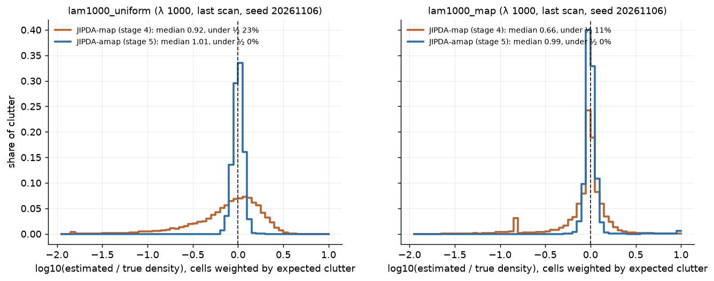

# Radar Track Lab 5단계: 클러터 지도 고치기(JIPDA-amap)와 원뿔 유지 v2

브랜치 `hyh4867/radar-stage5`(시작점 `hyh4867/radar-clutter-map` ca2a6df). 사전 등록 `docs/PREREGISTRATION_5.md`. 4단계 결과를 보고 세운 후속 실험이다.

## 세 줄 요약

1. **판정: 1부 개선, 2부(H1) 개선.** 1부 JIPDA-amap(n_min 20, τ 30)은 스히폴 lam1000_map 가짜 항적을 scan당 13.10(4단계) → 4.38(참 밀도 JIPDA 3.97)로 줄였고, 고른 클러터 붕괴(105)를 1.36으로 없앴다(JIPDA 1.38). 2부 H1(원뿔 유지 + Mode C 고도 확인)은 사전 등록한 네 항목을 모두 만족했다. 다만 KATL 회복률과 "11/13 구간" 항목은 경계였다.
2. 핵심 수치: JIPDA-amap / JIPDA GOSPA 비는 스히폴 다섯 조건에서 1.013–1.060, KATL lam1000_map에서 1.068(가짜 항적 비 1.328)이다. H1 회복률은 KATL_1106_peak EKF 54.7% [38.8, 70.3], IMM 59.8% [40.6, 78.6](4단계 36.5%, 31.0%)이고, EHAM 113%/111%다. 가짜 항적 비는 26개 모두 1.072 이하다.
3. 남은 문제: 1부는 λ5에서 놓친 표적 +0.29/scan과 확정 지연 +4.8 s가 남는다(바닥값, 미변경). KATL에서는 참 밀도와의 차이가 스히폴보다 크다. 2부의 이득 일부는 오차 없는 Mode C를 연관에 쓴 덕분이다. KATL의 "가까운 다른 항공기와 바뀜"(run당 29.2 → 38.1)은 줄지 않았다. H2(고도 외삽)는 H1과 거의 같았다.

## 1. 한 일

- 4단계 ClutterMapDensity(1 km × 1.5°, 지수 망각)에 칸 넓히기를 더한 AdaptiveClutterMapDensity를 `src/radar_track_lab/jpda.py`에 추가했다. 방법 이름은 `jipda_amap`이다.
  - 칸마다 창을 1×1 → 3×3 → 5×5 …칸으로 넓힌다. 창 안의 지수 가중 개수 합이 n_min에 이르면 멈춘다.
  - 상한은 9 km × 22.5°다. 10 km × 22.5°에 들어가는 가장 큰 홀수 칸 창이다. 상한에서도 모자라면 상한 창 값을 쓴다.
  - 바닥값, 제외 규칙, JIPDA 동결값은 4단계와 같다.
- 2부용 원뿔 유지 v2(H1, H2)를 `src/radar_track_lab/cone.py`에 추가했다.
  - 고도 확인을 연관에 넣으려고 EKF·IMM의 `_associate`에 `_extra_gate` 훅을 넣었다. 기본값은 아무것도 거르지 않는다.
- 단위 시험 12개를 추가했다(`tests/test_stage5_amap.py` 6개, `tests/test_stage5_cone_v2.py` 6개).
- 퇴행 확인: 코드를 바꾼 뒤 JIPDA, JIPDA-est, 4단계 JIPDA-map, 4단계 원뿔 유지와 M4를 seed 2개로 다시 돌렸다. 11개 파일 모두 seed별 summary 전체와 ID switch·misses 잃음이 기존 값과 같다(`results/stage5/regression.json`).
- 조정 → 동결 → 평가 순서를 지켰다. 커밋 순서는 11절에 있다.

## 2. 선택 (조정 구간만)

EHAM_1106_tune, M0, seed 20271106–20271110. 점수 = max(lam1000_map GOSPA 비, lam1000_uniform GOSPA 비)이고, 비는 같은 조건 JIPDA GOSPA에 대한 비다(`results/stage5/tune_selection.json`).

| 후보 | 점수 | map GOSPA 비 | uniform GOSPA 비 | map 가짜 항적 /scan | uniform 가짜 항적 /scan |
|---|---:|---:|---:|---:|---:|
| **n20_30** | **1.006** | 1.001 | 1.006 | 2.29 | 1.05 |
| n20_100 | 1.022 | 1.003 | 1.022 | 2.31 | 1.08 |
| n5_30 | 1.023 | 1.009 | 1.023 | 2.27 | 1.00 |
| n5_100 | 1.034 | 1.025 | 1.034 | 2.46 | 1.03 |
| (기준) JIPDA | – | 3,661 m | 2,992 m | 2.35 | 1.08 |

- 네 후보의 차이는 작다(점수 1.006–1.034). 넓히기만으로 4단계 후보(최고 GOSPA 5,317 m, 가짜 항적 9.86)와 비교가 안 될 만큼 나아졌다.
- JIPDA 기준값 출처: map은 `results/stage4/tune/EHAM_1106_tune__jipda__lam1000_map.json`, uniform은 이번 새 실행 `results/stage5/tune/EHAM_1106_tune__jipda__lam1000_uniform.json`이다.

## 3. 평가 결과 (EHAM_1106_eval, M0, seed 20261106–20261125)

출처: `results/stage5/summary.md`, `results/stage5/summary.json`. JIPDA-amap만 새 실행이다(`results/stage5/eval/`). JIPDA와 JIPDA-est(lam1000)는 `results/stage3/b1/`, JIPDA-est(lam200·lam5)와 JIPDA-map은 `results/stage4/eval/`이다.

### 3.1 판정: 개선

| 조건 | 항목 | 값 | 기준 | 결과 |
|---|---|---:|---|---|
| A | lam1000_map GOSPA 짝 차이 amap − est | −3,796 m [−4,188, −3,405] | 평균 < 0, 상한 < 0 | 만족 |
| A | lam200_map GOSPA 짝 차이 amap − est | −8,214 m [−8,635, −7,792] | 평균 < 0, 상한 < 0 | 만족 |
| B | lam1000_uniform GOSPA / 가짜 항적 비 | 1.013 / 0.991 | ≤ 1.10 | 만족 |
| B | lam5_map GOSPA / 가짜 항적 비 | 1.060 / 0.972 | ≤ 1.10 | 만족 |
| B | lam5_uniform GOSPA / 가짜 항적 비 | 1.016 / 0.982 | ≤ 1.10 | 만족 |

비는 JIPDA-amap / JIPDA, seed 평균의 비다.

### 3.2 평균 (seed 20개)

| 조건 | 방법 | 가짜 항적 /scan | GOSPA (m) | 놓친 표적 /scan | ID switch | 확정 지연 (s) | 실행 시간 (s) |
|---|---|---:|---:|---:|---:|---:|---:|
| lam1000_map | JIPDA | 3.97 | 3,817 | 2.61 | 31.35 | 39.12 | 76 |
| | JIPDA-est | 28.34 | 7,755 | 2.59 | 50.30 | 24.04 | 213 |
| | JIPDA-map (4단계) | 13.10 | 5,800 | 3.17 | 34.35 | 45.83 | 774 |
| | **JIPDA-amap** | **4.38** | **3,959** | 2.75 | 31.25 | 40.28 | 74 |
| lam1000_uniform | JIPDA | 1.38 | 2,870 | 2.07 | 36.30 | 31.58 | 19 |
| | JIPDA-est | 1.37 | 2,883 | 2.12 | 35.75 | 32.09 | 19 |
| | JIPDA-map (4단계) | 105.21 | 11,480 | 2.44 | 85.35 | 31.95 | 335 |
| | **JIPDA-amap** | **1.36** | **2,906** | 2.19 | 35.75 | 33.40 | 25 |
| lam200_map | JIPDA | 1.33 | 2,565 | 1.36 | 31.45 | 22.06 | 19 |
| | JIPDA-est | 57.95 | 10,846 | 1.40 | 35.25 | 21.29 | 13 |
| | JIPDA-map (4단계) | 8.88 | 4,295 | 1.62 | 39.80 | 23.72 | 17 |
| | **JIPDA-amap** | **1.44** | **2,632** | 1.42 | 31.25 | 22.85 | 15 |
| lam5_map | JIPDA | 0.93 | 2,055 | 0.59 | 30.35 | 9.62 | 0.7 |
| | JIPDA-est | 0.90 | 2,173 | 0.88 | 30.05 | 14.23 | 0.7 |
| | JIPDA-map (4단계) | 0.88 | 2,255 | 1.08 | 29.70 | 16.46 | 0.7 |
| | **JIPDA-amap** | **0.90** | **2,178** | 0.88 | 30.20 | 14.39 | 2.6 |
| lam5_uniform | JIPDA | 0.89 | 2,125 | 0.78 | 27.90 | 13.07 | 0.6 |
| | JIPDA-est | 0.88 | 2,160 | 0.86 | 28.40 | 14.18 | 0.7 |
| | JIPDA-map (4단계) | 0.86 | 2,241 | 1.06 | 26.80 | 16.50 | 0.7 |
| | **JIPDA-amap** | **0.88** | **2,159** | 0.86 | 28.45 | 14.15 | 2.6 |

### 3.3 짝 차이 (95% t-구간, 쌍 20개)

| 조건 | 차이 | 가짜 항적 /scan | GOSPA (m) | 놓친 표적 /scan | ID switch | 확정 지연 (s) |
|---|---|---:|---:|---:|---:|---:|
| lam1000_map | amap − JIPDA | +0.40 [+0.09, +0.71] | +141 [+70, +213] | +0.14 [+0.10, +0.18] | −0.10 [−1.23, +1.03] | +1.16 [+0.39, +1.93] |
| lam1000_map | amap − 4단계 map | −8.72 [−9.58, −7.86] | −1,841 [−1,998, −1,684] | −0.41 [−0.51, −0.31] | −3.10 [−5.01, −1.19] | −5.54 [−6.49, −4.59] |
| lam1000_uniform | amap − JIPDA | −0.01 [−0.04, +0.02] | +36 [+24, +48] | +0.11 [+0.09, +0.14] | −0.55 [−1.33, +0.23] | +1.82 [+1.35, +2.29] |
| lam1000_uniform | amap − 4단계 map | −104 [−106, −102] | −8,574 [−8,814, −8,334] | −0.25 [−0.31, −0.19] | −49.60 [−54.55, −44.65] | +1.45 [+0.59, +2.31] |
| lam200_map | amap − JIPDA | +0.12 [+0.07, +0.16] | +67 [+49, +85] | +0.06 [+0.04, +0.08] | −0.20 [−0.89, +0.49] | +0.79 [+0.42, +1.16] |
| lam5_map | amap − JIPDA | −0.03 [−0.03, −0.02] | +123 [+119, +127] | +0.29 [+0.29, +0.30] | −0.15 [−0.85, +0.55] | +4.77 [+4.64, +4.90] |
| lam5_uniform | amap − JIPDA | −0.02 [−0.02, −0.01] | +34 [+31, +37] | +0.08 [+0.08, +0.09] | +0.55 [−0.12, +1.22] | +1.08 [+1.03, +1.14] |

- 메움 비율(JIPDA-est와 JIPDA 사이 간격 중 메운 몫): lam1000_map에서 가짜 항적 0.983, GOSPA 0.964다(4단계 0.626, 0.497). lam200_map에서는 0.998, 0.992다(4단계 0.867, 0.791).
- JIPDA와 비교하면 아직 작은 손해가 있다. 모든 조건에서 GOSPA가 1–6% 높고, 놓친 표적이 많고, 확정이 늦다(짝 구간이 0을 넘음). 가장 큰 곳은 lam5_map이다(GOSPA +123 m, 놓친 표적 +0.29, 확정 +4.8 s). JIPDA-est와 거의 같은 값(GOSPA 차이 +4 m)이라, 바닥값이 참 밀도보다 커서 생기는 손해로 본다. 칸 넓히기와는 관계가 없다.
- lam1000_map 가짜 항적 비는 1.101로 1.10을 조금 넘는다. 판정 B 대상 조건은 아니다.
- 실행 시간: λ5에서 seed당 0.7 s → 2.6 s로 늘었다. scan마다 지도 전체(99 × 240칸, 창 8단계)를 다시 계산하기 때문이다. λ1000에서는 가짜 항적이 줄어 4단계보다 훨씬 빠르다(774 s → 74 s).

### 3.4 그림: 추정 밀도 / 참 밀도



`results/stage5/figures/density_ratio.png`, 수치는 `results/stage5/density_ratio.json`(`scripts/stage5_figure.py`). 평가 구간 seed 20261106의 마지막 scan이다. 칸마다 기대 클러터 개수(참 밀도 × 칸 부피)로 가중했다.

| 조건 | 방법 | 가중 중앙값 비 | 참값 2배 안 클러터 비율 | 참값 절반 미만 클러터 비율 |
|---|---|---:|---:|---:|
| lam1000_uniform | JIPDA-map (4단계) | 0.92 | 69% | 23% |
| lam1000_uniform | JIPDA-amap | 1.01 | 99.99% | 0% |
| lam1000_map | JIPDA-map (4단계) | 0.66 | 86% | 11% |
| lam1000_map | JIPDA-amap | 0.99 | 99.1% | 0.002% |

- 4단계 JIPDA-map의 lam1000_map 수치(0.66, 11%)는 4단계 그림(`results/stage4/density_map.json`)과 같다. 같은 seed를 같은 코드로 다시 돌린 결과다.
- JIPDA-amap이 고른 창 크기(lam1000_uniform)를 보면 클러터의 98%가 5×5칸(k=2) 창에 있다. lam1000_map에서는 30%가 1×1칸, 48%가 3×3칸이고, 6%는 상한 창까지 넓어졌다. 몰린 구역은 좁은 창, 드문 배경은 넓은 창을 쓴다.
- 독립 확인: 이 그림은 평가 실행과 별도로 추정기 격자를 직접 읽어 참 밀도와 비교한 것이다. JIPDA-amap의 비는 1.00이 아니라 흩어져 있다(중앙값 0.99–1.01). 참 밀도를 쓰지 않고 탐지점으로 추정했다는 뜻이다.

## 4. 예측 대 실제 (1부)

| 항목 | 에이전트 예측 | 검수자 예측 | 실제 |
|---|---|---|---|
| 선택 | n_min 20, τ 30 | n_min 20, τ 100 | **n_min 20, τ 30** (n20_100은 2위) |
| lam1000_uniform 가짜 항적 /scan | 1.6 (1.3–3) | 2 (1.3–4) | **1.36** (두 범위 안) |
| lam1000_map 가짜 항적 /scan | 11 (7–15) | 14 (10–20) | **4.38** (두 범위 밖, 아래) |
| lam1000_map GOSPA | 5,500 m (4,800–6,300) | 6,000 m (5,300–7,000) | **3,959 m** (두 범위 밖, 아래) |
| lam200_map GOSPA | 3,900 m (3,000–4,500) | 3,500 m (2,800–4,600) | **2,632 m** (두 범위 밖, 아래) |
| lam5_map GOSPA 비 | 1.09 (1.05–1.12) | – | **1.060** (범위 안) |
| 판정 | 개선 30%, 부분 개선 65% | – | **개선** |

- 두 예측 모두 lam1000_map이 크게 나아지지 않을 것으로 보았다. 에이전트는 "확정 항적이 클러터를 먹어 밀도를 낮게 잡는 되먹임"이 남는다고 보았는데, 틀렸다.
- 실제로 4단계 지도의 손해는 대부분 드문 배경 칸의 과소 추정에서 왔다. 몰린 클러터 조건에도 배경 10%가 고르게 깔려 있다. 그 배경을 1 km × 1.5° 칸으로 세면 칸당 scan당 약 0.004개라 바닥값까지 떨어진다. 그 결과 가짜 항적이 생기고, 생긴 가짜 항적이 탐지점을 먹어 다시 과소 추정이 된다. 넓히기가 첫 고리를 끊어서 되먹임도 같이 사라진 것으로 본다. 그림(3.4)의 배경 칸 수치가 이 해석과 맞는다. 다만 원인을 따로 떼어 시험하지는 않았다.

## 5. 사전 등록과 달라진 점, 실행 세부

- 조정과 평가가 예상보다 빨라서(lam1000_map seed당 약 75 s), 평가가 18:47에 끝났다. 일정만 바뀌었고 규칙은 바꾸지 않았다.
- 동작 확인 실행 3개(사전 등록 1절)는 판정에 쓰지 않았다.
- 평가의 느린 세 조건은 seed를 두 프로세스로 나눠 돌리고 `scripts/stage5_merge.py eval`로 합쳤다(20261106–15는 eval/, 20261116–25는 eval_p2/).
- 메모리 대기: 전 구간(18:05–19:40) 대기 없음. 스왑은 1.7 GB 안팎이었다. 이 시간에 다른 세션의 시뮬레이션·학습 프로세스는 보이지 않았다.
- 2부는 1부 보고서 push(19:05, ef6ee58) 뒤에 시작했다. KATL 일반화는 2부가 끝난 뒤(19:27) 시작했다. 04:30 규칙에 걸린 실행은 없다.
- 2부 결과 정리에서 고친 점: 처음 쓴 보고서 초안에는 "H1 − 4단계 유지 상한 < 0인 곳 22개 중 15개"라고 적었으나, 다시 세어 17개로 고쳤다(`results/stage5/cone_summary.json`).
- 실행 로그(`results/stage5/logs/`)는 `.gitignore` 대상이라 커밋하지 않았다. 수치의 출처는 모두 커밋된 결과 json이다.

## 6. 테스트

`.venv/bin/python -m pytest -v`, 18:50 KST, 1부 평가 뒤: **95 passed in 37.82s**. 실패와 건너뜀은 없다. 4단계 83개에 이번 12개를 더한 수다. 전체 출력을 아래에 그대로 싣는다(로컬 경로는 `<project>`로 바꿈). 2부와 KATL 실행 뒤 19:41에 `-q`로 다시 돌린 결과도 **95 passed in 33.19s**다(그 사이에는 스크립트만 추가됨).

```
============================= test session starts ==============================
platform darwin -- Python 3.12.8, pytest-9.2.0, pluggy-1.7.0 -- <project>/.venv/bin/python
cachedir: .pytest_cache
rootdir: <project>
configfile: pyproject.toml
testpaths: tests
collecting ... collected 95 items

tests/test_audit.py::test_update_common_sample_with_asynchronous_times_and_exclusions PASSED [  1%]
tests/test_audit.py::test_scan_end_common_sample_drops_the_hard_pair_and_can_flip_the_comparison PASSED [  2%]
tests/test_audit.py::test_duplicate_and_mismatched_keys_are_errors PASSED [  3%]
tests/test_audit.py::test_paired_difference_and_percent_reduction_by_hand PASSED [  4%]
tests/test_audit.py::test_unpaired_target_is_excluded_from_the_scan_end_sample PASSED [  5%]
tests/test_audit.py::test_recording_does_not_change_scores_and_reproduces_both_rmses[ekf] PASSED [  6%]
tests/test_audit.py::test_recording_does_not_change_scores_and_reproduces_both_rmses[nn] PASSED [  7%]
tests/test_audit.py::test_recording_does_not_change_scores_and_reproduces_both_rmses[imm] PASSED [  8%]
tests/test_audit.py::test_prediction_only_baseline_extrapolates_the_last_two_detections_by_hand PASSED [  9%]
tests/test_audit.py::test_prediction_only_baseline_shares_the_baseline_association_and_leaves_its_scores_alone PASSED [ 10%]
tests/test_audit.py::test_three_way_common_scan_end_sample PASSED        [ 11%]
tests/test_audit.py::test_ekf_hold_output_reports_the_last_updated_position_and_shares_the_ekf_updates PASSED [ 12%]
tests/test_audit.py::test_ekf_hold_output_position_by_hand PASSED        [ 13%]
tests/test_ekf_tracker.py::test_single_target_straight_line_converges PASSED [ 14%]
tests/test_ekf_tracker.py::test_ekf_reduces_error_vs_raw_measurement PASSED [ 15%]
tests/test_ekf_tracker.py::test_gate_threshold_and_mahalanobis PASSED    [ 16%]
tests/test_ekf_tracker.py::test_gating_rejects_far_detection PASSED      [ 17%]
tests/test_ekf_tracker.py::test_hungarian_assignment_global_optimum PASSED [ 18%]
tests/test_ekf_tracker.py::test_m_of_n_confirmation_and_deletion PASSED  [ 20%]
tests/test_ekf_tracker.py::test_track_ids_persist_and_are_not_reused PASSED [ 21%]
tests/test_ekf_tracker.py::test_componentwise_assignment_matches_dense_solve PASSED [ 22%]
tests/test_geo.py::test_azimuth_convention_clockwise_from_north PASSED   [ 23%]
tests/test_geo.py::test_polar_cartesian_round_trip PASSED                [ 24%]
tests/test_geo.py::test_wrap_pi PASSED                                   [ 25%]
tests/test_geo.py::test_polar_cov_cross_range PASSED                     [ 26%]
tests/test_geo.py::test_geodetic_enu_round_trip_and_scale PASSED         [ 27%]
tests/test_geo.py::test_velocity_rotation_meridian_convergence PASSED    [ 28%]
tests/test_imm.py::test_transition_matrix_is_a_markov_semigroup PASSED   [ 29%]
tests/test_imm.py::test_ct_predict_exact_circle_small_omega_and_jacobian PASSED [ 30%]
tests/test_imm.py::test_turn_is_detected_and_tracked_better_than_cv PASSED [ 31%]
tests/test_imm.py::test_straight_line_accuracy_not_worse_than_cv PASSED  [ 32%]
tests/test_imm.py::test_nees_on_model_matched_truth PASSED               [ 33%]
tests/test_imm.py::test_imm_single_target_management_like_ekf PASSED     [ 34%]
tests/test_metrics_repro.py::test_gospa_known_values PASSED              [ 35%]
tests/test_metrics_repro.py::test_same_seed_reproducible_and_different_seed_differs PASSED [ 36%]
tests/test_metrics_repro.py::test_clutter_rate_matches_lambda PASSED     [ 37%]
tests/test_metrics_repro.py::test_hermite_exact_for_constant_acceleration PASSED [ 38%]
tests/test_metrics_repro.py::test_anees_bounds_contain_dof PASSED        [ 40%]
tests/test_privacy.py::test_dbflags_exclusion PASSED                     [ 41%]
tests/test_stage2.py::test_extractor_writes_no_identifier_column PASSED  [ 42%]
tests/test_stage2.py::test_processed_point_files_hold_only_allowed_columns PASSED [ 43%]
tests/test_stage2.py::test_committed_outputs_carry_no_identifier_fields PASSED [ 44%]
tests/test_stage2.py::test_sites_are_outside_korea_and_extract_script_applies_dbflags PASSED [ 45%]
tests/test_stage2.py::test_truth_turn_rate_matches_the_known_manoeuvre PASSED [ 46%]
tests/test_stage2.py::test_lost_track_in_a_known_turn_is_classified_as_turn PASSED [ 47%]
tests/test_stage3_c2_breakdown.py::test_breakdown_definitions PASSED     [ 48%]
tests/test_stage3_c2_breakdown.py::test_breakdown_rejects_inconsistent_events PASSED [ 49%]
tests/test_stage3_jpda.py::test_two_tracks_one_shared_detection_by_hand PASSED [ 50%]
tests/test_stage3_jpda.py::test_exact_matches_brute_force_and_lbp_is_close PASSED [ 51%]
tests/test_stage3_jpda.py::test_single_track_jipda_reduces_to_ipda PASSED [ 52%]
tests/test_stage3_jpda.py::test_pda_update_reduces_to_kalman_with_one_certain_detection PASSED [ 53%]
tests/test_stage3_jpda.py::test_grid_density_floor_and_average PASSED    [ 54%]
tests/test_stage3_jpda.py::test_trackers_follow_ncv_targets[jpda] PASSED [ 55%]
tests/test_stage3_jpda.py::test_trackers_follow_ncv_targets[jipda] PASSED [ 56%]
tests/test_stage3_jpda.py::test_jipda_rejects_dense_clutter_better_than_gnn PASSED [ 57%]
tests/test_stage3_jpda.py::test_jipda_with_certain_existence_equals_jpda PASSED [ 58%]
tests/test_stage3_pregate.py::test_adaptive_pregate_equals_no_pregate_ekf[5.0] PASSED [ 60%]
tests/test_stage3_pregate.py::test_adaptive_pregate_equals_no_pregate_ekf[200.0] PASSED [ 61%]
tests/test_stage3_pregate.py::test_adaptive_pregate_equals_no_pregate_imm PASSED [ 62%]
tests/test_stage3_pregate.py::test_pregate_radius_by_hand PASSED         [ 63%]
tests/test_stage3_pregate.py::test_fixed_6km_drops_a_gated_pair_that_adaptive_keeps PASSED [ 64%]
tests/test_stage3_sensor.py::test_swerling1_pd_by_hand PASSED            [ 65%]
tests/test_stage3_sensor.py::test_swerling1_matches_monte_carlo PASSED   [ 66%]
tests/test_stage3_sensor.py::test_calibration_by_hand PASSED             [ 67%]
tests/test_stage3_sensor.py::test_horizon_by_hand PASSED                 [ 68%]
tests/test_stage3_sensor.py::test_slant_and_elevation_against_vector_geometry PASSED [ 69%]
tests/test_stage3_sensor.py::test_slant_to_ground_round_trip_and_mode_c PASSED [ 70%]
tests/test_stage3_sensor.py::test_clutter_map_fractions_and_near_mean PASSED [ 71%]
tests/test_stage3_sensor.py::test_clutter_map_density_integrates_to_lambda_and_is_fixed_per_site PASSED [ 72%]
tests/test_stage3_sensor.py::test_merge_groups_by_hand PASSED            [ 73%]
tests/test_stage3_sensor.py::test_simulate_merge_reports_one_detection_at_the_mean PASSED [ 74%]
tests/test_stage3_sensor.py::test_simulate_cone_of_silence_and_slant_correction PASSED [ 75%]
tests/test_stage3_sensor.py::test_all_elements_off_reproduces_the_stage_1_model PASSED [ 76%]
tests/test_stage4_clutter_map.py::test_cell_boundaries PASSED            [ 77%]
tests/test_stage4_clutter_map.py::test_exponential_forgetting_arithmetic PASSED [ 78%]
tests/test_stage4_clutter_map.py::test_floor_is_jipda_est_floor_density PASSED [ 80%]
tests/test_stage4_clutter_map.py::test_converges_to_true_map_density[1000.0-1.5-30.0] PASSED [ 81%]
tests/test_stage4_clutter_map.py::test_converges_to_true_map_density[2000.0-3.0-100.0] PASSED [ 82%]
tests/test_stage4_clutter_map.py::test_uniform_clutter_matches_uniform_density PASSED [ 83%]
tests/test_stage4_cone.py::test_hold_time_formula PASSED                 [ 84%]
tests/test_stage4_cone.py::test_with_modec_attaches_quantised_altitude_to_target_reports_only PASSED [ 85%]
tests/test_stage4_cone.py::test_track_held_through_cone_and_not_deleted PASSED [ 86%]
tests/test_stage4_cone.py::test_hold_expires_after_t_max PASSED          [ 87%]
tests/test_stage5_amap.py::test_cap_half_widths PASSED                   [ 88%]
tests/test_stage5_amap.py::test_widening_stops_at_n_min PASSED           [ 89%]
tests/test_stage5_amap.py::test_cap_used_when_short_and_floor_kept PASSED [ 90%]
tests/test_stage5_amap.py::test_azimuth_wraps_and_range_edge_is_cut PASSED [ 91%]
tests/test_stage5_amap.py::test_box_sums_match_brute_force PASSED        [ 92%]
tests/test_stage5_amap.py::test_uniform_synthetic_clutter_converges_to_truth PASSED [ 93%]
tests/test_stage5_cone_v2.py::test_window_constants PASSED               [ 94%]
tests/test_stage5_cone_v2.py::test_vz_estimate_fit_clip_and_short_history PASSED [ 95%]
tests/test_stage5_cone_v2.py::test_alt_gate PASSED                       [ 96%]
tests/test_stage5_cone_v2.py::test_h1_holds_through_cone_like_stage4 PASSED [ 97%]
tests/test_stage5_cone_v2.py::test_h1_gate_rejects_other_altitude_and_clutter PASSED [ 98%]
tests/test_stage5_cone_v2.py::test_h2_extrapolates_altitude_for_cone_entry PASSED [100%]

============================= 95 passed in 37.82s ==============================
```

## 7. 남은 문제 (1부)

- **바닥값**: λ5에서 놓친 표적 +0.29/scan, 확정 지연 +4.8 s(lam5_map)가 남는다. JIPDA-est도 같은 손해를 본다. 바닥값(10 km × 22.5° 칸당 10 scan에 1개)을 자료로 정하는 방법은 시험하지 않았다.
- **한 구간, 한 측정 모형**: 판정은 스히폴 평가 구간 하나와 M0에서 했다. 클러터 배치는 시간에 따라 변하지 않는다. 움직이는 기상 클러터처럼 바뀌는 클러터에서 τ 30이 충분히 빠른지는 시험하지 않았다.
- **후속 실험**: 4단계 결과를 본 뒤 세운 방법이고, 평가 구간과 seed가 4단계와 같다. 평가 구간에 맞춘 선택은 없었지만, 독립된 구간에서 다시 확인할 필요가 있다. KATL 확인은 [KATL] 절에 있다.
- **원인 분해 없음**: 개선이 드문 배경 칸에서 왔다는 해석(4절)은 그림 수치와 맞지만, 배경만 넣은 조건 같은 분리 실험은 하지 않았다.
- **KATL**: 메움 비율이 0.93/0.88로 스히폴보다 낮고, 가짜 항적이 JIPDA의 1.33배다(10절). 교통이 더 많은 곳에서 남는 차이의 원인은 보지 않았다.

### 7.1 남은 문제 (2부)

- **Mode C를 이상적으로 다룸**: 오류·누락 Mode C가 없다. 실제 SSR에서는 고도 확인이 틀린 보고를 막거나 맞는 보고를 거절할 수 있다. 이번 이득은 상한에 가깝다고 봐야 한다.
- **KATL 회복률 구간이 넓다**: EKF [38.8, 70.3], IMM [40.6, 78.6]. 판정 1은 점 추정으로 만족했지만, 구간은 50% 아래를 포함한다.
- **KATL의 남은 원뿔 손실과 늘어난 이웃 바뀜**: 15 km 안 원뿔 손실이 run당 3.95 남는다. "가까운 다른 항공기와 바뀜"은 4단계 유지 때와 같은 수준(38)이다. 원인은 분석하지 않았다.
- **H2 가설 기각에 가까움**: 고도 외삽으로 원뿔 진입을 판단해도 거의 바뀌지 않았다(26개 중 24개 동일).

## 8. 사이트 문구 제안 (반영하지 않음)

현재 사이트는 1단계 기준이다. 클러터 문구를 고친다면 다음을 제안한다.

"이 비교에서는 허위 탐지 밀도를 안다고 가정했습니다. 탐지점만으로 밀도를 추정하면, 고정 격자(10 km × 22.5°)는 허위 탐지를 한 구역에 몰아 넣은 조건에서 가짜 항적이 scan당 28.3으로 늘었습니다(참 밀도 3.97). 자료가 적은 곳에서 칸을 넓히는 추정(1 km × 1.5°에서 최대 9 km × 22.5°)은 4.38로, 참 밀도를 준 경우에 가까웠습니다. 시뮬레이션 한 구간에서 잰 값이고, 클러터는 시간에 따라 변하지 않습니다."

원뿔 문구를 넣는다면 다음을 제안한다.

"레이더 바로 위 원뿔에서는 탐지가 없어 항적이 끊깁니다. 원뿔 안에 있는 동안 항적을 지우지 않고 유지하고, 다시 나올 때 Mode C 고도가 맞는 보고만 받게 하면, 원뿔 때문에 늘어난 ID switch 중 스히폴에서는 거의 전부, 애틀랜타에서는 약 55–60%를 되찾았습니다. 오차 없는 Mode C를 가정한 시뮬레이션 결과입니다."

## 9. [2부] 원뿔 유지 v2 (M4, 13개 구간, EKF·IMM, seed 20개)

출처: `results/stage5/cone_summary.md`, `results/stage5/cone_summary.json`, 실행 파일 `results/stage5/cone/`. 원뿔 끔은 EHAM_1106_eval과 KATL_1106_peak만 `results/stage3/diag_near/`이고, 나머지 11개 구간은 새로 돌렸다. 1부 보고서를 push한 뒤(19:05) 시작해 19:27에 끝났다.

**중요한 조건**: H1·H2는 Mode C 고도를 **연관에도** 쓴다. 4단계 유지는 Mode C를 원뿔 판단에만 썼다. 실제 SSR 추적처럼 정보를 하나 더 쓰는 것이다. 이 시뮬레이션의 Mode C에는 오차가 없다(100 ft 양자화만 있고 오류·누락 보고는 없음). 따라서 실제보다 유리한 조건이다.

### 9.1 H1 판정: 개선 (네 항목 모두 만족, 두 항목은 경계)

| 항목 | 기준 | 실제 | 결과 |
|---|---|---|---|
| 1 KATL 회복률 | EKF·IMM 모두 ≥ 50% | EKF 54.7% [38.8, 70.3], IMM 59.8% [40.6, 78.6] | 만족(점 추정 기준; 두 구간 모두 50% 아래를 포함) |
| 2 EHAM 회복률 | EKF·IMM 모두 ≥ 80% | EKF 113.1% [100.0, 128.7], IMM 111.4% [98.5, 125.6] | 만족 |
| 3 가짜 항적 | 26개(13구간 × 2) 모두 ≤ 1.10 × M4 | 최대 KATL_1106_peak EKF 1.072 | 만족 |
| 4 EKF ID switch < M4 | 13개 중 11개 이상 | 11개 | 만족(경계) |

- 4번에서 빠진 두 구간은 ENGM_1106_peak과 ENGM_1111_same이다. 원뿔 효과가 0이라(M4 = 원뿔 끔) 유지가 한 번도 일어나지 않았고, 값이 M4와 똑같다.
- 부분 개선 조건(KATL에서 H1 − 4단계 유지 상한 < 0)도 만족한다. EKF −3.50 [−4.40, −2.60], IMM −5.45 [−6.66, −4.24].

### 9.2 회복률 (ID switch seed 평균)

| 구간 | 방법 | M4 | 원뿔 끔 | 4단계 유지 | H1 | 회복률 4단계 → H1 | H1 − 4단계 유지 |
|---|---|---:|---:|---:|---:|---:|---:|
| EHAM_1106_eval | EKF | 36.15 | 30.05 | 30.70 | 29.25 | 89.3% → 113.1% | −1.45 [−2.01, −0.89] |
| EHAM_1106_eval | IMM | 28.30 | 21.70 | 22.95 | 20.95 | 81.1% → 111.4% | −2.00 [−2.66, −1.34] |
| KATL_1106_peak | EKF | 210.80 | 191.50 | 203.75 | 200.25 | 36.5% → 54.7% | −3.50 [−4.40, −2.60] |
| KATL_1106_peak | IMM | 196.80 | 177.90 | 190.95 | 185.50 | 31.0% → 59.8% | −5.45 [−6.66, −4.24] |
| KATL_1111_same | EKF | 182.70 | 173.30 | 184.30 | 179.70 | −17.0% → 31.9% | −4.60 [−6.06, −3.14] |
| KATL_1111_same | IMM | 172.15 | 164.10 | 173.65 | 168.65 | −18.6% → 43.5% | −5.00 [−6.29, −3.71] |
| EGLL_1106_peak | EKF | 77.60 | 68.90 | 71.30 | 69.35 | 72.4% → 94.8% | −1.95 [−2.49, −1.41] |
| EHAM_1106_busy2 | IMM | 23.75 | 15.60 | 19.45 | 17.20 | 52.8% → 80.4% | −2.25 [−3.01, −1.49] |
| LSZH_1106_peak | EKF | 44.30 | 32.90 | 35.55 | 33.60 | 76.8% → 93.9% | −1.95 [−2.55, −1.35] |

나머지 구간은 `results/stage5/cone_summary.md`에 있다. 원뿔 효과가 있는 11개 구간 × 2방법에서 H1은 4단계 유지보다 ID switch가 같거나 적다. 짝 구간 상한이 0보다 작은 곳은 22개 중 17개다.

### 9.3 해석과 한계

- **회복률 100% 초과(EHAM, LSZH_1111_same, EGLL_1111_same)**: H1이 원뿔을 끈 경우보다 ID switch가 적다. 고도 확인이 원뿔과 관계없는 바뀜도 막기 때문이다. 예를 들어 EHAM EKF의 "가까운 다른 항공기와 바뀜"은 6.30 → 4.75로 줄었다. 그러므로 H1의 이득을 모두 "원뿔 효과 되찾기"로 읽으면 안 된다. 일부는 오차 없는 Mode C를 연관에 쓴 이득이다.
- **KATL의 "가까운 다른 항공기와 바뀜"은 줄지 않았다**: KATL_1106_peak EKF에서 M4 29.20, 4단계 유지 38.65, H1 38.05(run당)다. H1의 KATL 이득은 이 원인이 아니라 misses 잃음 감소(25.50 → 16.00 → 12.85)와 15 km 안 원뿔 손실 감소(17.00 → 7.30 → 3.95)에서 왔다. 고도 확인은 유지 중이거나 막 나온 항적의 첫 갱신까지만 걸리는데, 늘어난 바뀜은 그 뒤에 일어나는 것으로 보인다. 이 부분은 확인하지 않았다.
- **H2는 H1과 거의 같다**: 26개 중 24개에서 ID switch가 H1과 정확히 같다. 다른 곳은 EHAM_1106_busy2 두 개뿐이다(EKF 25.65 → 25.55, IMM 17.20 → 17.00). "상승 중인 항공기가 유지 대상에서 빠진다"는 가설은 이 자료에서 남은 손실의 주원인이 아니다. 남은 KATL 원뿔 손실(run당 3.95)이 무엇인지는 아직 모른다.
- **부작용**: 가짜 항적은 4단계 유지보다 적다(KATL EKF 비 1.119 → 1.072). RMSE는 KATL에서 약 6% 늘고(4단계와 비슷), 놓친 표적은 약 20% 줄고, GOSPA는 2–7% 준다(`cone_summary.md` 부작용 표).
- **퇴행 확인**: 이 스크립트로 돌린 M4는 3단계 diag_near와 EHAM·KATL의 seed 20개 × ID switch·misses 잃음이 모두 같다.

### 9.4 예측 대 실제 (2부)

| 항목 | 에이전트 예측 | 검수자 예측 | 실제 |
|---|---|---|---|
| H1 KATL 회복률 EKF | 50% (35–70%) | 55% (35–75%) | **54.7%** (두 범위 안) |
| H1 KATL 회복률 IMM | 45% (30–65%) | – | **59.8%** (범위 안) |
| H1 EHAM 회복률 EKF / IMM | 90% / 85% | – | **113.1% / 111.4%** (위) |
| H1 KATL 가까운 다른 항공기와 바뀜(EKF) | 32 (29–37) | 32 (28–37) | **38.05** (두 범위 밖, 위) |
| H1 KATL EKF 가짜 항적 / M4 | 1.10 (1.04–1.14) | – | **1.072** (범위 안) |
| H2 − H1 KATL 회복률 | +5%p 안팎 | – | **0%p** |
| H1 판정 | 개선 20%, 부분 개선 60% | – | **개선** |

- 두 예측 모두 고도 확인이 "가까운 다른 항공기와 바뀜"을 줄일 것으로 보았다. 그 부분은 틀렸다. 회복률은 다른 경로(원뿔 손실 감소)로 예측 범위에 들어갔다.

## 10. [KATL] 1부 일반화 확인: KATL_1106_peak (판정과 별도, seed 8개)

출처: `results/stage5/summary.md` 끝 절. JIPDA-amap 두 조건과 lam1000_uniform의 JIPDA·JIPDA-est는 새 실행이다(`results/stage5/katl/`, 19:27–19:40). lam1000_map의 JIPDA·JIPDA-est·JIPDA-map은 4단계 파일이다(`results/stage4/katl/`). seed는 20261106–20261113이다. 시간이 충분해서 사전 등록한 8개를 줄이지 않았다.

| 조건 | 방법 | 가짜 항적 /scan | GOSPA (m) | 놓친 표적 /scan | ID switch |
|---|---|---:|---:|---:|---:|
| lam1000_map | JIPDA | 4.79 | 5,350 | 7.51 | 218 |
| | JIPDA-est | 27.07 | 8,469 | 7.51 | 340 |
| | JIPDA-map (4단계) | 13.05 | 6,948 | 9.37 | 207 |
| | **JIPDA-amap** | **6.37** | **5,715** | 7.91 | 221 |
| lam1000_uniform | JIPDA | 2.81 | 4,799 | 6.96 | 196 |
| | JIPDA-est | 2.79 | 4,826 | 7.13 | 194 |
| | **JIPDA-amap** | **2.74** | **4,887** | 7.49 | 192 |

- lam1000_map 메움 비율: 가짜 항적 0.929, GOSPA 0.883(4단계 JIPDA-map 0.629, 0.488). 스히폴(0.983, 0.964)보다 덜 메웠다.
- JIPDA-amap / JIPDA: lam1000_map에서 가짜 항적 1.328, GOSPA 1.068. 짝 차이는 가짜 항적 +1.57 [+0.77, +2.38], GOSPA +365 m [+237, +493]다. 스히폴(1.101, 1.037)보다 참 밀도와의 차이가 크다. 1부 판정 규칙을 KATL에 그대로 적용한다면 조건 B에 해당하는 비교는 아니지만, 가짜 항적 비가 1.10을 넘는다.
- lam1000_uniform: 붕괴는 없다(가짜 항적 2.74, JIPDA 2.81). 놓친 표적이 0.53 많고 확정이 2.7 s 늦다. 4단계 JIPDA-map은 KATL uniform을 돌리지 않아서 직접 비교는 없다.
- 4단계 JIPDA-map 대비 ID switch가 KATL lam1000_map에서 +13.75 [+5.22, +22.28] 많다. JIPDA-map은 확정이 늦고 놓친 표적이 많아 항적 자체가 적었기 때문으로 보인다(놓친 표적 −1.45, 확정 지연 −8.7 s). JIPDA와의 차이는 +3.25 [−3.64, +10.14]로 0을 포함한다.

## 11. commit

| commit | 내용 |
|---|---|
| 96fe2b6 | 사전 등록(1부·2부), JIPDA-amap, 원뿔 유지 v2, 단위 시험(실행 전) |
| 873946c | 퇴행 확인 결과, 큐·선택·보고 스크립트 |
| 31f48c0 | 조정 결과, 선택 동결(n20_30) |
| c08059a | 1부 평가 결과, 밀도 그림 |
| ef6ee58 | 1부 보고서(19:05 push) |
| f19f873 | 2부 결과(13개 구간), KATL 큐 스크립트 |
| (이 commit) | KATL 일반화 결과, 사전 등록 덧붙임, 이 보고서 최종본 |
